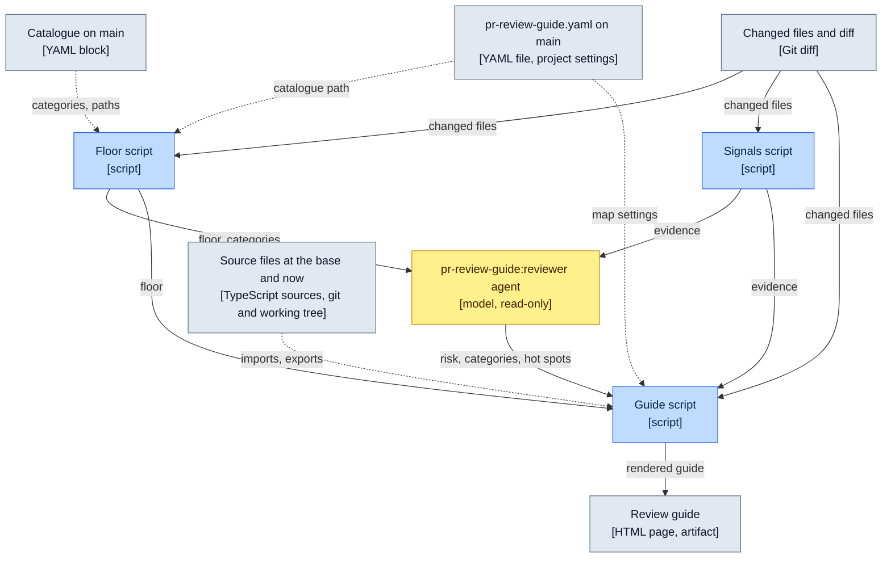

# Review guide plugin

The catalogue exists because a reader of an agent's pull request should know where to spend
attention. A model can judge a diff, but its worst mistake is calling a dangerous change low
risk. So the rules in the [catalogue format](catalogue-format.md) set a **floor** by path patterns and diff checks, and the model may only raise the
risk above it.

The manual has four parts:

- [README.md](README.md): how the plugin is used, with the flow from the changed files to the Review guide.
- [catalogue-format.md](catalogue-format.md): the risk levels, the catalogue's fields, the diff checks and the matching rules.
- [review-guide.md](review-guide.md): the agent's answer and the Review guide page.
- [changeset-map.md](changeset-map.md): the changeset map on the guide page.

Ideas that are not planned yet are in the [backlog](../BACKLOG.md).

## How it is used

`/pr-review-guide` runs this flow when the maintainer reviews a branch; only the floor script runs
when a PR opens, through the pr-review-guide plugin's hook (without the plugin, run `pnpm review:floor`). The guide describes the commit it names: run the command again after new commits.

Legend: solid line = data passed on, dotted line = file read. Scripts are deterministic; the agent is the only model step.

| Step | Role |
|---|---|
| **Floor script** | Reads the **project settings** `pr-review-guide.yaml` from the base branch (`origin/main`, else `main`), never from the pull request being checked, also when given a commit to start from. Then reads the **catalogue** the settings name from the base branch too. Today that is the YAML block of [docs/technical/pr-review-catalogue.md](../../../../docs/technical/pr-review-catalogue.md), which is also the default when there is no settings file or no `catalogue` key. Settings that are malformed or name a catalogue the base branch lacks stop the floor with an error. It matches the changed files against **the catalogue** and reports the matched categories and the highest minimum risk. |
| **Signals script** | Gathers evidence for the agent: git history (changes and `fix:` commits per file over the last six months, the ten files with most fixes first), the `pnpm metrics` hotspots, changed-line coverage (it runs the unit tests itself, within two minutes) and the dependency diff with the `pnpm audit` advisories that hit a version the change added (audit needs network access). It prints `history`, `metrics`, `coverage` and `dependencies`. A section that cannot run says "not available". A signal may be missing and never sets a category. |
| **`pr-review-guide:reviewer` agent** | Receives the floor and the evidence. It may raise the risk, add categories and name hot spots. It may never go below the floor. |
| **Guide script** | Takes the higher of the floor and the agent's risk, keeps the floor's categories plus the catalogue names the agent added, drops hot spots that are not a changed line, adds the signal facts to the hot spots, turns the rest of the signals into the "Not verified" section and renders the guide page. It also reads the changed files itself (since the floor's commit, when the floor had one) and the imports and exports of the source files at that commit (else the merge base with the default branch) and now, and builds the changeset map from them (see [Changeset map](changeset-map.md)), with the hot spots, skim-only files and responsibilities marked on it. |
