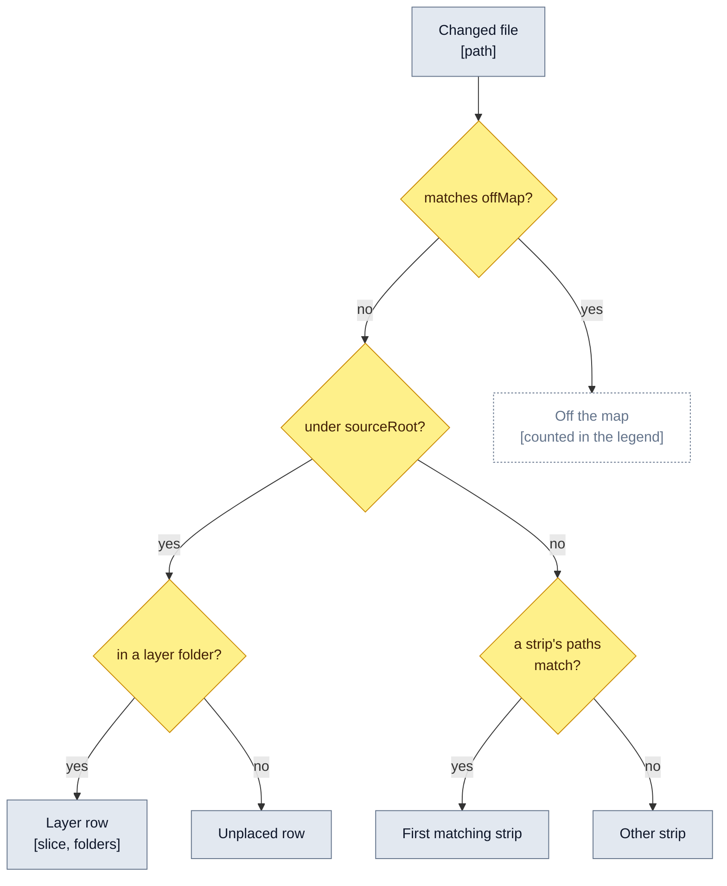
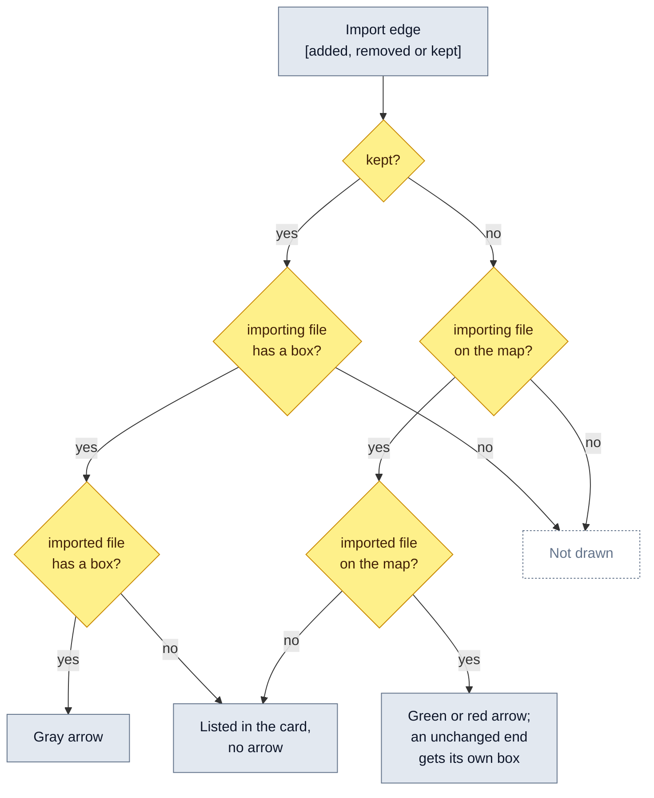
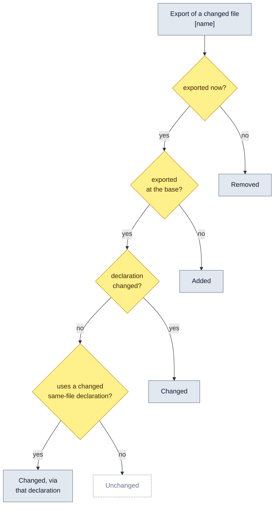
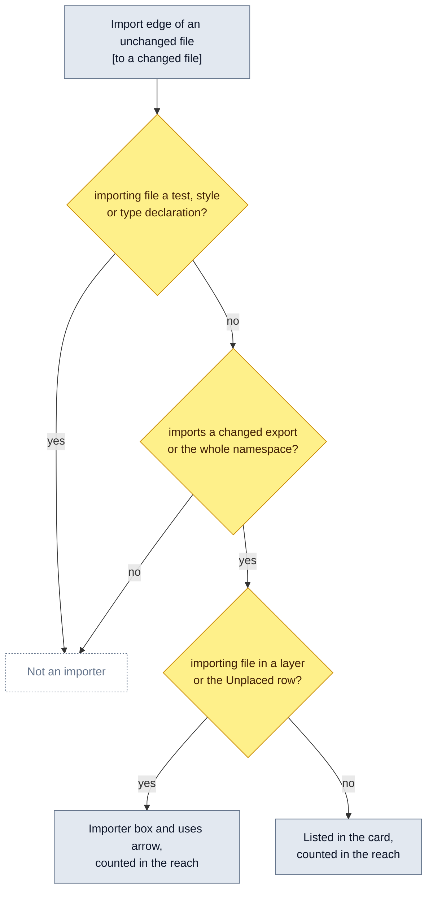
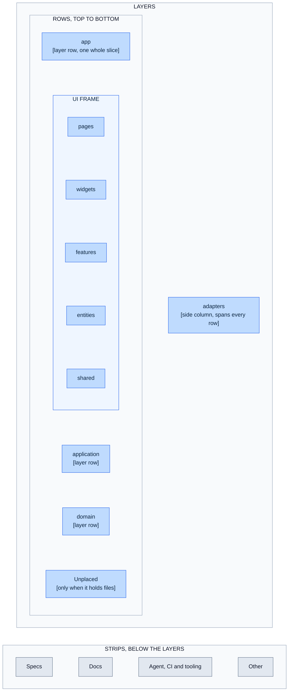
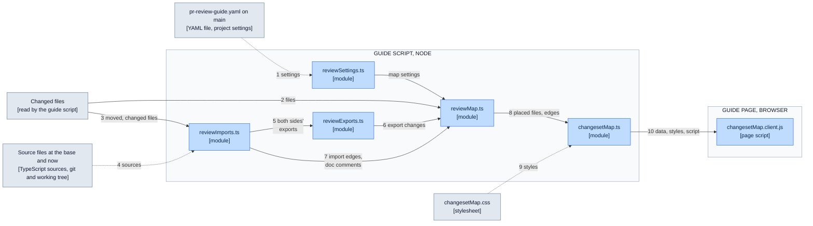

# Changeset map

The map shows where a branch's changes sit in the app, which imports between them it adds and
removes, and which unchanged files use what it changed, so a reader sees which rows and slices a
change touches, how it rewires them and what else it can break before reading the hot spots. A
**row** is drawn per configured layer, a **slice** is the first folder below it, and a
**folder** is any folder deeper down. An **import edge** is a pair of files: the file that
imports, and the file that declares the imported name. A **changed export** is an export of a
changed file whose declaration, or a same-file declaration it uses, changed; an **importer** is
an unchanged file that uses one; a changed file's **reach** is the number of its importers.

## Where a file goes

Legend: diamond = check, in this order; the first match decides; dashed box = nothing marked on the map.

The checks and their patterns come from the `map` settings in the project settings
`pr-review-guide.yaml` at the repository root (`offMap`, `sourceRoot`, `layers`, `strips`), read from
the base branch like the catalogue, so a change to them shows on the map of later pull requests. A
moved file is placed by its new path; its old place gets a ghost only when both places are on the
map.

## Which imports are drawn

Legend: diamond = check, in this order; the first match decides; dashed box = nothing marked on the map.

| Arrow | Means | Line | Shown |
|---|---|---|---|
| Added import | Only in the working tree | Green, solid | Unless its legend checkbox is cleared; always from the active box |
| Removed import | Only at the base | Red, dashed | Unless its legend checkbox is cleared; always from the active box |
| Kept import | In both; a moved file counts under its new path, so its imports stay kept | Gray, thin | Only from the active box |
| Uses arrow | An importer's import of a changed export | Text colour, dotted | All while the importers checkbox is on |

A uses arrow stands in for the kept arrow of the same import, and a box counts its uses arrows
as its own at either end. The **active box** is the one the pointer is on, else the one with
keyboard focus, else the pinned one. Imports of one kind between the same two boxes, such as several files of a
collapsed folder, are drawn as one arrow with their count; an import between two files of the
same collapsed folder gets no arrow, and the folder's card lists it. Arrows run under the
boxes.

## Which exports changed

Legend: diamond = check, in this order; the first match decides; dashed box = nothing marked on the map.

A declaration changed when its text differs from the base with comments and layout left out, so
a change to a doc comment alone changes nothing. "Uses" follows the same-file declarations it
refers to through any number of steps. Every export of a deleted file is removed, every export
of an added file added.

## Who uses a changed export

Legend: diamond = check, in this order; the first match decides; dashed box = nothing marked on the map.

The first check uses the map's `offMap` patterns. A name a file only re-exports is not a use, so
an unchanged barrel is no importer. A namespace used as a whole counts only when it is imported
from the changed file itself, not through a barrel. A removed export has no importers: a file
that still imports one does not compile, and the type check reports it. Only one step is
followed: the importers of an importer are not drawn.

## What the page shows

Legend: boxes are parts of the map as drawn; the UI frame and the side column come from the
configuration.

| Part | What it shows | `map` settings | Interaction |
|---|---|---|---|
| Legend | Three rows: **Boxes** (the statuses and the skim-only look), **Show** (a checkbox each for added imports, removed imports and unchanged importers, with their counts), **Marks** (the hot spot number, the reach badge, the API chip, the kept arrow); then how to use the map and the off-map count | | The importers checkbox starts cleared |
| Layer row | The changed files of one layer, by slice and folder | `layers`, in drawing order | |
| UI frame | The FSD layers `pages` to `shared`, drawn inside one frame | `group: ui` | |
| Side column | `adapters`, at the right edge across every row | `side: true` | |
| Slice | The first folder below a layer, in a dashed frame | `wholeSlice: true` makes a layer one slice | Starts collapsed with more than four changed files; collapsed, it shows a count per status |
| Folder | A deeper folder; a chain of single-child folders shows as one name (`session-history/ui`) | | One with two or more entries collapses and reopens by its name only; a collapsed one is a box that can be pinned like a file box |
| File box | One changed file: status sign and name | | Becomes the active box on hover or focus: its card opens, its own arrows show and the rest fade; a click pins it until a second click or Esc |
| Unchanged-file box | An unchanged file at either end of an added or removed import | | Like a file box |
| Importer box | An importer | | Shown only while the importers checkbox is on; otherwise like a file box |
| Hot spot number | The numbers of the file's hot spots, on the box's top-right corner; on a collapsed folder, the numbers of every file in it; inside a strip row at its end | | A screen reader hears "hot spot n" with the box or row |
| Skim-only look | A box or strip row the agent marked skim-only: its status colour washed out with stripes, gray name. Only changed files are skim-only; a collapsed folder takes the look when all of its changed files are skim-only | | A screen reader hears "skim only" with the box, and the reason with a strip row; a strip row also shows the reason on hover |
| Reach badge | `↗n` on a changed file box: its reach, with a box or not; none at 0 | | A screen reader hears "used by n unchanged files" |
| API chip | `API +n −m`: the names the barrels in a folder added to and removed from their re-exports; beside an open folder's name, inside a collapsed folder's box | | A screen reader hears "public API: n added, m removed" |
| Card | **Every card**: the box's path, the responsibility (a changed file drawn as a box and not skim-only), the status, the hot spot numbers, and the skim-only entry and reason when all of the box is skim-only. **Changed file**: its exports, the changed ones bold, and its importers with the names they use. **Importer**: its leading doc comment and the changed exports it uses. **Collapsed folder**: each file's changed exports only. **Every box**: its imports added, removed and kept, each with its names. A file that has no box is marked "not on the map" | | Shown for the active box; Esc closes it. A screen reader hears a one-line summary of it as the box's description: the responsibility, the status, the skim-only reason and the counts |
| Import arrow | One arrow per kind between two boxes, with a count when it stands for several import edges; see [Which imports are drawn](#which-imports-are-drawn) | | |
| Unplaced row | A file under `sourceRoot` in no layer folder | `sourceRoot` | |
| Strip | Files outside `sourceRoot`, by full path; a long folder is shortened, the name kept whole | `strips`, first match wins, `Other` last | Path and status on hover; "Show on map" moves focus to the row and flashes it |
| Off-map count | The number of files left off the map, in the legend | `offMap` | |

| Status | Sign | Box |
|---|---|---|
| Added | `+` | Green |
| Changed | `~` | Orange |
| Deleted | `−` | Red, name struck through |
| Moved | `→` | Purple; the card names the old path |
| Old place of a moved file | `⇠` | Dashed, empty; the card names the new path |
| Unchanged, at either end of an added or removed import | `·` | Dotted, gray name |
| Unchanged, uses a changed export | `◦` | Page background, solid border in the text colour |

A file that is both of the last two is drawn as an importer while the importers checkbox is on.
Unchanged-file and importer boxes are not counted as changed, in a collapsed folder's counts or
anywhere else. The page loads nothing from outside: the data, the styles and the page script are
inlined.

## How it is built

Legend: solid line = data passed on, dotted line = file read; numbers give the order.

The import edges come from two TypeScript programs over `tsconfig.app.json`: one on the commit
the map starts from, read from git into memory, and one on the working tree. Each imported name
is followed to the file that declares it, so a barrel never stands between two boxes; a
barrel's own re-exports are edges too. The same pass lists each file's exports, its top-level
declarations as their tokens without comments, the same-file declarations each one refers to,
and its leading doc comment. When the programs cannot be built, the map is drawn without arrows,
importers, exports or API chips, and the legend says why.

| File (`.claude/skills/pr-review-guide/scripts/`) | Role |
|---|---|
| `reviewSettings.ts` | Reads the project settings `pr-review-guide.yaml` from the base branch by its exact path: the catalogue path for the floor and the `map` settings for the map |
| `reviewImports.ts` | Builds the two TypeScript programs once, reads their import edges and export facts, and compares the edges |
| `reviewExports.ts` | Compares the two sides' export facts: the added, removed and changed exports of each changed file, and each barrel's added and removed re-exports |
| `reviewMap.ts` | Checks the configuration, places the changed files, adds the unchanged files at either end of an added or removed import and the importers, counts the reach and the API chips, and keeps the edges whose importing file has a box |
| `changesetMap.ts` | Renders the map section: the legend, the placed files as embedded data, and the inlined styles and page script |
| `changesetMap.css` | The map's styles; its status colours follow the light or dark theme that `reviewGuide.css` sets |
| `changesetMap.client.js` | Draws the rows, slices, folders, file boxes, strips, import and uses arrows, reach badges and API chips in the browser, lets the reader open and collapse folders, pin a box, hide a kind of arrow and show the importers, and shows the card |
