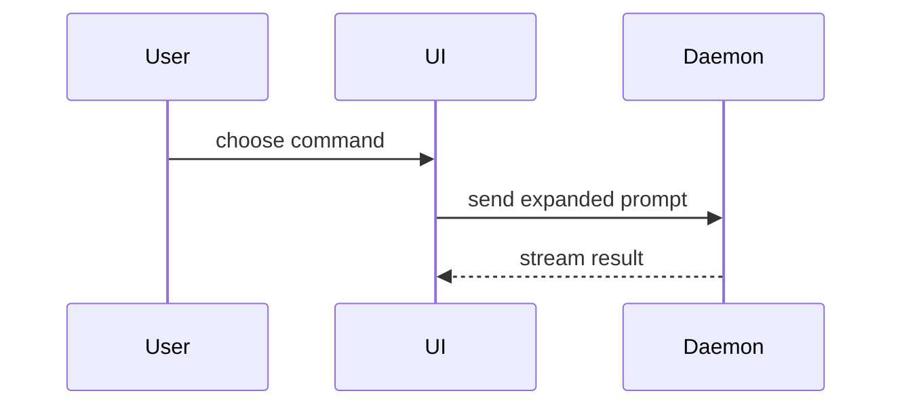

## Plan review

When the user asks to see or review the plan/strategy for an issue, task or feature, present it for approval instead of explaining a topic. Stop afterwards: no branch, edits or todo list until the user approves. Read the relevant issue, `docs/architecture.md` and `docs/architecture-rules.md` first, and cite rules by name. Use the views below to show:

1. **Goal and scope**: one or two sentences, plus what is explicitly out of scope.
2. **Approach**: two to four views (file-tree diff, layer/slice placement, call or data flow, step sequence). Draw each at the level where the user can disagree with it.
3. **Decisions**: each real fork with its options, trade-offs and your recommendation. Do not list options you would not pursue.
4. **Open questions**: only those the user must answer.
5. **Verification**: how you will prove it works (tests, checks, manual run).

Publish it as an artifact (see "Artifact" below) so the user can comment on individual decisions. After the user says they commented, read the comments with `ArtifactComments`, revise the plan, and republish to the same URL. Small plans may stay in the terminal.

## Explaining a topic

Help the user understand the current topic of conversation visually. Skip the preamble and keep prose brief. Pick the smallest view that makes the key point clear.

- Show logic or an algorithm as pseudocode:

```text
on(save)
  if content is unchanged
    return cached result
  write new content
  return fresh result
```

- Show runtime control flow as a call tree:

```text
submitForm
  createSession
    persistPrompt
    launchAgent
  navigateToSession
```

- Show UI structure as a component tree, including state and module boundaries that matter:

```tsx
<SessionPage> (apps/example/src/routes/session.tsx)
  useSessionEvents()
  <SessionToolbar>
    <RunSkillButton> (packages/ui)
```

- Show file responsibility or a broad refactor as a shallow file tree:

```text
src/
├── commands/       # parses user actions
├── sessions/       # owns session state
└── transport/      # sends API requests
```

- Show component interaction, control flow, or data flow with Mermaid:



- Use `diff` when the point is what changes and the surrounding shape already exists. Match the diff shape to the topic.

For a component change:

```diff
 <SessionPage>
   useSessionEvents()
   <SessionToolbar>
+    <RunSkillButton />
   <SessionTimeline>
+    <SkillResultCard />
```

For a file-layout change:

```diff
 src/
 ├── commands/
+│   └── show-me.ts       # expands the slash command
 ├── sessions/
-└── transport.ts
+└── transport/
+    ├── client.ts
+    └── stream.ts
```

For a call-tree or call-stack change:

```diff
 submitForm
   createSession
     persistPrompt
+    expandSkillMention
     launchAgent
-  navigateToSession
+  navigateToSession
+    subscribeToEvents
```

For a state or control-flow change:

```diff
 on(save)
-  write content
+  if content is unchanged
+    return cached result
+  write new content
+  invalidate cache
```

- Show the whole block when most of it is new, when omitted context would hide ownership or order, or when the user needs a copyable target shape:

```ts
function expandSkill(command: string): string {
  const skillName = command.slice(1)
  return `use the ${skillName} skill`
}
```

- For a visual UI, layout, state comparison, or concept too dense for Mermaid, or for any plan review, publish one focused artifact (see "Artifact" below) — a diagram, an infographic, or a short slide deck, whichever fits the point. Match the product's colors, type, spacing, and components (Nocturne for UI mockups); use real labels and data.

### Artifact

Use the `Artifact` tool: load the `artifact-design` skill first, write the HTML to the scratchpad directory, and publish it (private by default). Republish to the same file path or `url` when revising. Do not declare runtime capabilities: the artifact's built-in comments are enough, and `ArtifactComments` reads them. Give the user the link.

### guidance

Place each visual next to the short text it supports. Keep only the calls, files, props, states, and boundaries needed to answer the user's current question or the options to resolve the current discussion point.

You may use one of these, you may use several, it is unlikely you will use all of them. Use your judgement and don't overwhelm the user.
