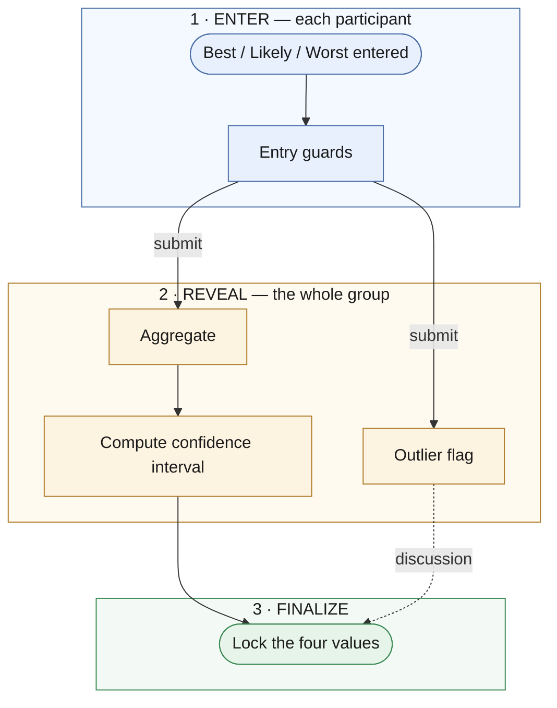

# Estimation Method — Domain Concept

Three-point estimation: for each item, best/most likely/worst case become a defensible
range and a 90% confidence interval, and a set of bias guards actively counters the known
estimation traps (symmetric ranges, underestimated worst case, false precision). Source:
Developer's Guide to Software Estimation (agiledojo.de, Episodes I–III). See
[PRD](../prd.md) §5 (Estimation Model) for the short product-facing summary.

## Process

Each item goes through three phases. In Manual mode the facilitator enters one reconciled
value: it is its own group range, and there is no outlier flag.

Solid arrows show the order of the steps; the dotted arrow shows what the outlier flag
feeds into.



| Phase | Step | What happens | Notes | Spec |
|---|---|---|---|---|
| **Enter** | **Entry guards** | While a participant enters their own Best / Likely / Worst, the symmetric-range nudge, the rounding suggestion and the narrow-range nudge (see the bias guards below) react to that estimate | They check one participant's estimate, never the group range | [bias-guards](../../../specs/estimation-method/domain/bias-guards.feature) |
| **Reveal** | **Aggregate** | Individual submissions become one group range: **Best** = minimum of all Best Cases, **Worst** = maximum of all Worst Cases, **Likely** = median of all Likely values (the mean of the two middle values for an even count) | Don't average away the outliers — the worst case in particular tends to get optimistically averaged down. A single-entry group, as in Manual mode, degenerates to that one estimate's own values | [aggregation](../../../specs/estimation-method/domain/aggregation.feature) |
| **Reveal** | **Compute confidence interval** | 90% Confidence Interval = `Likely + 1.28 × ((Worst − Best) / 3)` | McConnell's formula, Episode III | [aggregation](../../../specs/estimation-method/domain/aggregation.feature) |
| **Reveal** | **Outlier flag** | Each participant's estimate is compared with the others' estimates (not with the group range), and one that stands apart is flagged | Prompts discussion before finalizing; Live mode only | [bias-guards](../../../specs/estimation-method/domain/bias-guards.feature) |
| **Finalize** | **Finalize** | The four values (min, expected, CI90, max) are locked for the item | | [final-result](../../../specs/estimation-method/domain/final-result.feature) |

## Information model

```yaml
Estimate:
  # Self-validating: only constructible with best ≤ likely ≤ worst — illegal ranges can't be represented
  best: number     # > 0
  likely: number   # ≥ best
  worst: number    # ≥ likely, ≤ 1,000,000 (any unit)

AggregateResult:
  # The group range produced by the Process above. Self-validating like Estimate:
  # only constructible when every field keeps its rule, whether it comes from
  # aggregating estimates or from a saved file
  min: number       # > 0, finite
  expected: number  # min ≤ expected ≤ max
  ci90: number      # = expected + 1.28 × ((max − min) / 3)
  max: number       # ≥ min

UncertaintyLevel:
  # One of 5 phases of the classic Cone of Uncertainty (see below); selected per item, per participant
  label: string
  agileEquivalent: string
  lowMult: number    # multiplier anchored to Best Case
  highMult: number   # multiplier anchored to Best Case
```

### Cone-of-uncertainty guidance levels

Each participant selects an uncertainty level from 5 phases, always preselected
("Requirements Complete," the middle phase) so guidance is visible as soon as best/worst
are entered. The level is local to that participant's own view, not shared or synced, and
can be changed at any time — a backlog mixes items of different maturity, and different
participants may reasonably assess the same item's maturity differently.

| Level | Agile equivalent | Low mult. | High mult. |
|---|---|---|---|
| Initial Concept | Product Vision | 0.25x | 4x |
| Approved Product Definition | Backlog w/ Epics | 0.5x | 2x |
| Requirements Complete | Refined Stories | 0.67x | 1.5x |
| UI Complete | Sprint Planning I | 0.8x | 1.25x |
| Detailed Design Complete | Sprint Planning II | 0.9x | 1.10x |

The multipliers are anchored to Best Case, not Most Likely — e.g. at "Initial Concept,"
Worst Case is expected to land around 4× (High mult. / Low mult. = 16x) the Best Case, not
4× Most Likely. The guidance ratio is always `High mult. / Low mult.`, computed from the
table at implementation time rather than stored as its own rounded column, since a rounded
display value can drift out of sync with the exact division.

## Rules (estimate and final result)

| Rule | Condition | Behavior | Spec |
|---|---|---|---|
| **A final result keeps every rule** | Any final result, aggregated or read from a file | **Accepted** only when every `AggregateResult` constraint in the information model holds; otherwise **rejected** with the rule it breaks | [final-result](../../../specs/estimation-method/domain/final-result.feature) |
| **An estimate keeps every rule** | Any estimate, from the form, from a peer, or the facilitator's reconciled value | **Accepted** only when every `Estimate` constraint in the information model holds; otherwise **rejected** with the rule it breaks | [estimate](../../../specs/estimation-method/domain/estimate.feature) |
| **An estimate stays within 1,000,000** | The `worst ≤ 1,000,000` constraint above, in any unit, from any of those sources | Why the limit exists: aggregating submissions can never produce a `ci90` too large to keep the final-result rule. The form says "Enter a smaller value" | [estimate](../../../specs/estimation-method/domain/estimate.feature) |

## Rules (bias guards)

These are nudges, not hard blocks — they never prevent submission or finalize. The 15% and 40% thresholds are current defaults, expected to be retuned after real sessions.

| Guard | Trigger | Behavior | Spec |
|---|---|---|---|
| **Symmetric range warning** | `(Likely − Best)` and `(Worst − Likely)` differ by at most 15% of `(Worst − Best)` | **Nudge:** the range looks symmetric, worst case in software usually has more room than best case | [bias-guards](../../../specs/estimation-method/domain/bias-guards.feature) |
| **False precision guard** | A value that isn't a multiple of the unit's granularity: whole hours, half days, half weeks (e.g. "3.7 days") | **Rounding suggestion** to the unit's expected granularity | [bias-guards](../../../specs/estimation-method/domain/bias-guards.feature) |
| **Outlier flag at reveal** | The participant's range has **no overlap** with the others' range, or their Likely is **more than 40%** of the others' range away from the others' median Likely — always compared with the others only, never with a range including their own | **Highlight** (not hide) the outlier, to prompt discussion rather than silently average it out | [bias-guards](../../../specs/estimation-method/domain/bias-guards.feature) |
| **Uncertainty-range guard** | The entered range (worst/best ratio) is narrower than the selected uncertainty level's guidance ratio, i.e. Worst is below the **guidance ceiling**, Best × High mult. / Low mult. | **Nudge:** the range looks narrow for that phase, teams at this stage typically see a wider spread. If the ratio already meets or exceeds guidance, show a **calm confirmation** instead | [bias-guards](../../../specs/estimation-method/domain/bias-guards.feature) |
