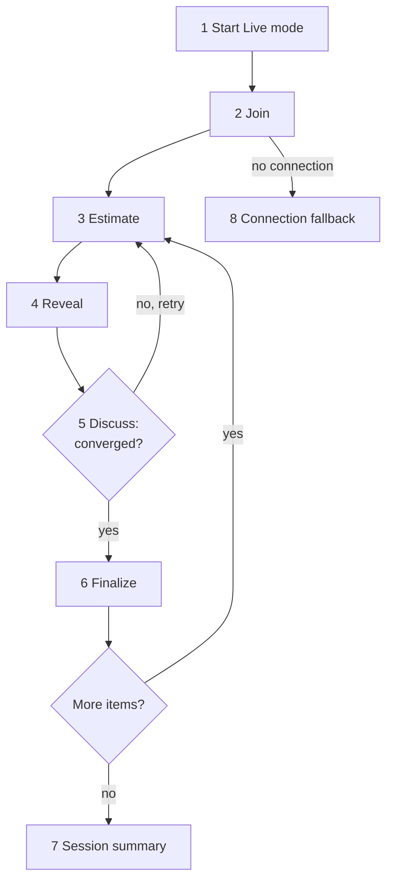
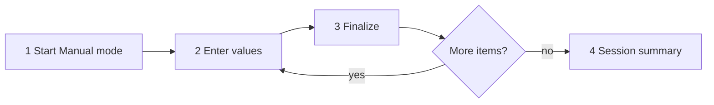
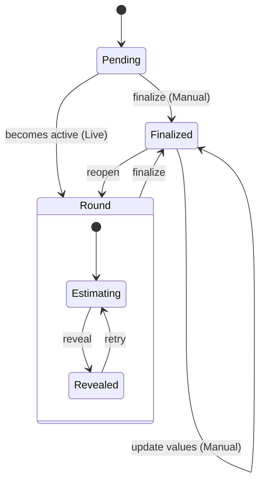

# Live Collaboration — Domain Concept

EstiMate has two session modes, **Live mode** and **Manual mode**. Both finalize each item
to the same `AggregateResult` (min, expected, ci90, max); only how the values get in
differs (see the rule **Both modes are interchangeable at the report**). Saving and loading
a session is its own concept, [session-persistence](session-persistence.md).
[PRD](../prd.md) §4.1 is the short product-facing summary of this process, §4.2 its
mode-comparison table.

## Process

### Live mode

The team estimates together in real time, each participant submitting their own numbers
from their own device.



1. **Start Live mode** — the facilitator starts a session and immediately gets a shareable
   session code; the session name and items are added afterwards, and can keep changing
   mid-session
2. **Join** — a participant enters the code and their name (named, not anonymous — enables
   direct discussion)
3. **Estimate** — for the active item, each participant privately submits Best Case, Most
   Likely and Worst Case in the session's unit
4. **Reveal** — the facilitator reveals the round, typically once everyone has submitted.
   It shows each participant's three values side by side, plus the group's
   `AggregateResult`
5. **Discuss** — the team discusses outliers; the facilitator can retry the round, which
   clears its submissions
6. **Finalize** — the facilitator locks in the `AggregateResult` of the submissions and
   moves on to the next item; a finalized item can be reopened (see
   [Round lifecycle](#round-lifecycle))
7. **Session summary** — all items with their four values; the session can be saved to a
   file
8. **Connection fallback** — a participant who never reaches the facilitator (e.g. a
   strict network at join time) is told so plainly and offered a retry (see the rule **No
   mid-session mode switch**)

### Manual mode

The facilitator ran the estimation discussion elsewhere (in person, on a call, over Slack)
and types in the team's agreed numbers to get the same calculated ranges, guards and
report. No connection, no participants joining.



1. **Start Manual mode** — the facilitator starts a session and lands on the Workspace,
   where the session name and items are added
2. **Enter values** — the facilitator types the group's agreed Best Case, Most Likely and
   Worst Case for the item (a single set of values, no per-participant breakdown); the
   same bias guards fire as in Live mode (see [estimation-method](estimation-method.md))
3. **Finalize** — the values are locked in and the `AggregateResult` is calculated; a
   finalized item can be updated with new values later
4. **Session summary** — the same report as in Live mode

## Information model

```yaml
Session:
  sessionName: string            # can change mid-session
  unit: enum                     # hours | days | weeks, can change mid-session
  mode: enum                     # live | manual, fixed when the session starts
  items: Item[]                  # in list order

Item:
  id: string
  title: string                  # never blank
  description: string
  notes: string                  # captured during discussion
  finalResult: AggregateResult | null   # null until finalized
  round: number                  # Live mode: starts at 0, +1 on each retry or reopen
  revealed: boolean              # Live mode: this round's estimates are visible
  submissions: Estimate[]        # Live mode, facilitator only: one per participant this round

Estimate:
  participantId: string          # Manual mode: the facilitator
  best: number                   # best <= likely <= worst (see estimation-method)
  likely: number
  worst: number

Participant:                     # Live mode only; no account
  participantId: string          # stable per browser, so a reconnect is the same person
  name: string

RosterEntry:                     # values-free: who has submitted, never what
  participantId: string
  submitted: boolean
  connected: boolean
```

### Round lifecycle

A **round** is one pass of everyone estimating one item in Live mode.



Retrying and reopening both clear the item's submissions and start a new round; reopening
also clears its `finalResult`.

## Rules

| Rule | Condition | Behavior | Spec |
|---|---|---|---|
| **Privacy before reveal** | Before the facilitator reveals the round | A participant never sees another's values: submissions go **only to the facilitator**, and everyone else sees a **values-free roster** | — |
| **No mid-session mode switch** | The live connection fails | The **mode is fixed** when the session starts; the facilitator starts a fresh **Manual-mode session** instead of switching the running one | — |
| **Late join and reconnect land on the correct view** | A participant joins mid-round, or reconnects | They see the **active item** and how many teammates have **submitted**, whatever they missed while away | [`late-joiner.feature`](../../../specs/live-session/e2e/late-joiner.feature) (late join only) |
| **Both modes are interchangeable at the report** | Always | The **session summary** and the **saved file** look the same whichever mode produced the values | — |
