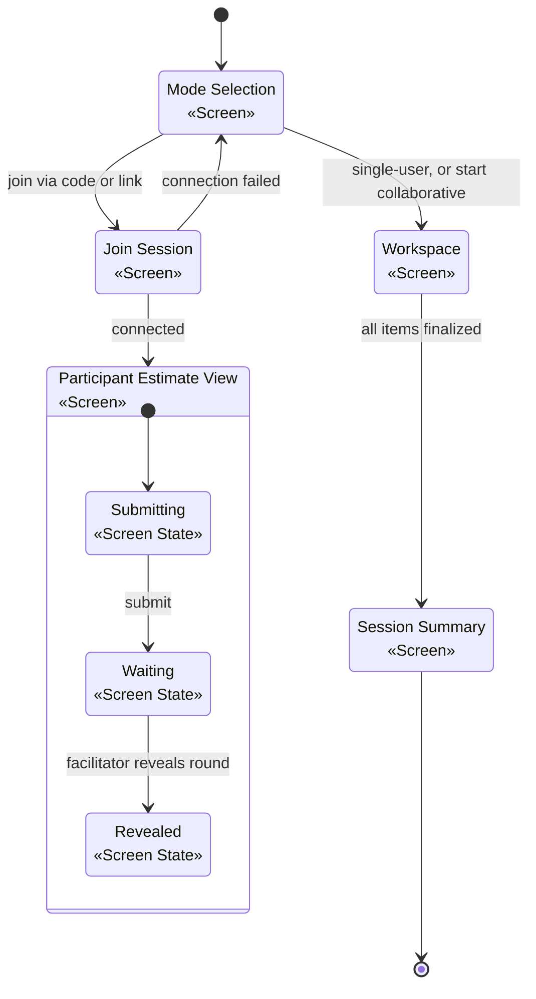

# Screen Flow — Domain Concept

EstiMate's screens are mostly mode-agnostic — single-user and collaborative sessions share
the same Workspace and Session Summary screens; only joining a collaborative session and
the participant's own estimating view differ. [PRD](../prd.md) §4 is the facilitator/
participant core flow this screen flow sits inside.

## Screen flow

## Screens

| Screen | Single-user | Collaborative | Layout & content | Key actions |
|---|---|---|---|---|
| **Mode selection** | ✓ | ✓ | Entry screen. No session setup happens here. **After a load:** a preview of the loaded session (name, item and finalized counts, unit); the two start actions then continue it, and Join and Load are hidden. A rejected file shows why. | Start single-user · Start collaborative (generates a session code) · Join via code · Load a saved session · Discard a loaded one |
| **Workspace** | ✓ | ✓ *(facilitator view)* | **Left:** editable session name, estimation unit, item list. **Right:** the active item's **estimation widget**, or an "add an item" prompt when nothing is selected. **Collaborative adds:** a session-code strip above; the facilitator sees **participant submission status** and a **reveal control** instead of direct inputs; reveal shows the **aggregated range** plus each participant's values. | Add / remove / reorder items (any time) · Rename item inline · Reveal round · Finalize item · Retry round · Save session (facilitator) |
| **Join Session** | – | ✓ | **Name field**, connecting indicator while the peer connection establishes. | Enter name · Join via code/link |
| **Participant Estimate View** | – | ✓ | **Read-only item detail**; three number inputs (**Best/Likely/Worst**). Submitted → waiting → revealed states shown in the diagram above; revealed mirrors the facilitator's aggregated range (no finalize/retry controls). | Submit |
| **Session Summary / Report** | ✓ | ✓ | All finalized items with **four values** — same layout regardless of mode. | Export (CSV/PDF/link) · Save |
