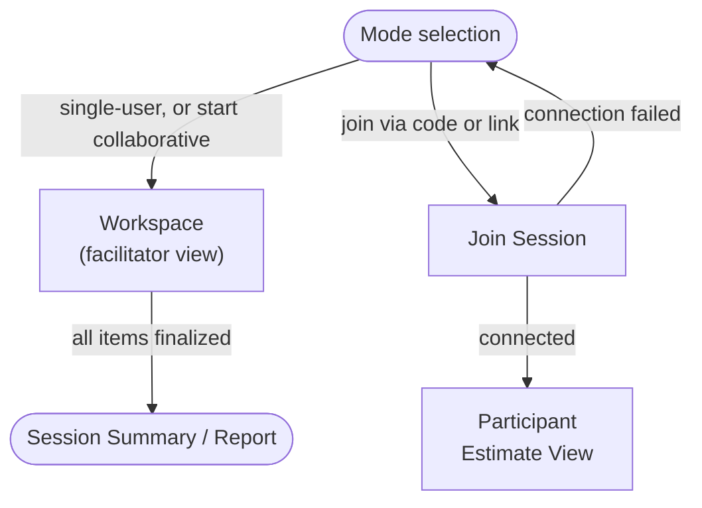

# Screen Flow — Domain Concept

EstiMate's screens are mostly mode-agnostic — single-user and collaborative sessions share
the same Workspace and Session Summary screens; only joining a collaborative session and
the participant's own estimating view differ. [PRD](../prd.md) §4 is the facilitator/
participant core flow this screen flow sits inside.

## Screen flow

## Screens

| Screen | Scope | Key content & actions |
|---|---|---|
| **Mode selection** | Both | Entry screen: start single-user, start collaborative (generates a session code), or join a collaborative session. No session setup happens here. |
| **Workspace** | Both — facilitator view in collaborative | The single working screen for both modes. Left: editable session name, estimation unit, and the item list (add / remove / reorder at any time, including mid-session; inline rename from the detail panel). Right: the active item's estimation widget, or an "add an item" prompt when nothing is selected. In collaborative mode a session-code strip (code, copy, participant count) sits above it, the facilitator sees participant submission status and a reveal control instead of direct inputs, and reveal shows the aggregated range plus each participant's values with **Finalize** / **Retry round**. |
| **Join Session** | Collaborative only | Enter name, join via code/link, connecting indicator while the peer connection establishes; a connection-failed state points to single-user mode as a fallback. |
| **Participant Estimate View** | Collaborative only | Read-only item detail, three number inputs (Best/Likely/Worst), submit; then a waiting state, then a revealed state mirroring the facilitator's aggregated range (no finalize/retry controls). |
| **Session Summary / Report** | Both | All finalized items with four values, export (CSV/PDF/link), saveable to a file — same layout regardless of mode. |
