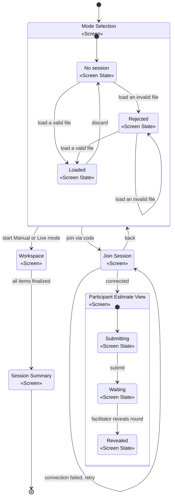

# Screen Flow — Domain Concept

EstiMate's screens are mostly mode-agnostic — Manual-mode and Live-mode sessions share the
same Workspace and Session Summary screens; only joining a Live-mode session and the
participant's own estimating view differ. [PRD](../prd.md) §4 is the facilitator/
participant core flow this screen flow sits inside.

## Screen flow

Arrows are transitions between screens or screen states, labelled with what causes them.

## Screens

| Screen | Manual mode | Live mode | Layout & content | Live mode adds | Key actions |
|---|---|---|---|---|---|
| **Mode selection** | ✓ | ✓ | Entry screen; no new session is set up here, but a saved one can be loaded. States shown in the diagram above: **Loaded** previews the session (name, item and finalized counts, unit) and hides Join and Load; **Rejected** says why the file can't be loaded. | — | "Start single-user" (Manual mode) · "Start collaborative" (Live mode, generates a session code) · Join via code · Load a saved session · Discard a loaded one |
| **Workspace** | ✓ | ✓ *(facilitator view)* | **Left:** editable session name, estimation unit, item list. **Right:** the active item's **estimation widget**, or an "add an item" prompt when nothing is selected. | A session-code strip above; the facilitator sees **participant submission status** and a **reveal control** instead of direct inputs; reveal shows the `AggregateResult` plus each participant's values. | Add / remove / reorder items (any time) · Rename item inline · Reveal round · Finalize item · Retry round · Save session |
| **Join Session** | – | ✓ | **Name field**, connecting indicator while the peer connection establishes; a failed connection is reported and offers a retry. | — | Enter name · Join via code · Retry |
| **Participant Estimate View** | – | ✓ | **Read-only item detail**; three number inputs (**Best/Likely/Worst**); its states are in the diagram above. Once revealed it mirrors the facilitator's `AggregateResult` (no finalize/retry controls). | — | Submit |
| **Session Summary / Report** | ✓ | ✓ | Every finalized item with its **min, expected and max** — same layout regardless of mode. | — | Save session |
