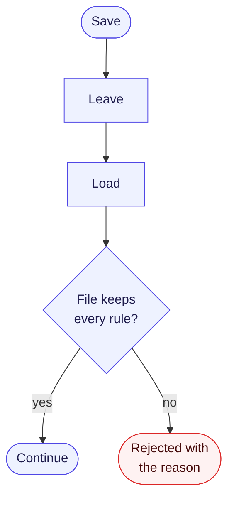

# Session Persistence — Domain Concept

A session lives only in the open browser tab. Saving it to a file is the only way it
outlives that tab: there are no accounts and no server-side storage ([PRD](../prd.md) §6,
"Session persistence"). Both modes save and load the same way ([live-collaboration](live-collaboration.md)
covers the modes themselves). Only the **facilitator** — the one person estimating in
Manual mode, the host in Live mode — holds the item list, so only the facilitator has a
session to save; a participant never does.

## Process

**Save and resume**



1. **Save** — at any point in either mode, the facilitator saves the session; the browser
   downloads it as a file
2. **Leave** — leaving the session, or closing the tab, is safe once it is saved; with
   unsaved changes, both ask for confirmation first
3. **Load** — later, on mode selection, the facilitator picks the saved file; it is checked
   whole, and either restored or rejected with the reason
4. **Continue** — the facilitator starts either mode with the loaded session, which resumes
   at the first item still needing an estimate

## Information model

```yaml
SavedSession:            # what a save keeps of a session
  sessionName: string    # may be empty
  unit: enum             # hours | days | weeks
  items: SavedItem[]     # every item, finalized or not, in order

SavedItem:               # an Item as saved: without its running round
  id: string             # not blank, unique within the saved session
  title: string          # not blank
  description: string
  notes: string
  finalResult: AggregateResult | null   # keeps every final-result rule; null = not estimated
```

`AggregateResult` is the four values of [estimation-method](estimation-method.md), checked by its rules there. A
running round's submissions, its reveal state and its round number are never part of a
saved session: they belong to participants of a session that won't exist when it is
restored. How a saved session is written to a file, and what the file is named, is a
technical concern.

## Rules

| Rule | Condition | Behavior | Spec |
|---|---|---|---|
| **A session survives only as a saved file** | The session holds changes that no saved or loaded file has | Leaving it, or closing the tab, **asks for confirmation** first. In a live session with connected participants, the leave confirmation **names both losses**: the unsaved changes and the session ending for everyone. Right after a save or a load, nothing asks | [what-counts-as-unsaved](../../../specs/session-persistence/domain/what-counts-as-unsaved.feature), [leaving](../../../specs/live-session/domain/leaving.feature), [unsaved-changes](../../../specs/session-persistence/e2e/unsaved-changes.feature) |
| **Only the facilitator can lose a session** | A participant in a live session | **Never asked** to confirm leaving for unsaved changes, and **offered no Save** | [leaving](../../../specs/live-session/domain/leaving.feature) |
| **A saved session holds no running round** | Saving in either mode | The saved session keeps name, unit and every item with its final result, **nothing of a round in progress** | [saved-session](../../../specs/session-persistence/domain/saved-session.feature) |
| **Load only before a mode starts** | A facilitator resumes a saved session | Loading happens **on mode selection**; the loaded session then starts in either mode. **No load is offered over a running session**: in a live one, replacing the item list under connected participants would silently put them out of sync | [save-and-resume](../../../specs/session-persistence/e2e/save-and-resume.feature) |
| **The browser's Back button never leaves a running session** | A mode is running, or a participant has joined, and the browser goes back to mode selection or Join | **The session's screen comes back** instead (the Workspace, or the participant's estimate screen), and says why: leaving goes only through the app's own leave, with its confirmation | [unsaved-changes](../../../specs/session-persistence/e2e/unsaved-changes.feature), [save-and-resume](../../../specs/session-persistence/e2e/save-and-resume.feature) |
| **A resumed session starts at the open work** | A loaded session starts | The **first item still needing an estimate** is active | [save-and-resume](../../../specs/session-persistence/e2e/save-and-resume.feature) |
| **A loaded final result stays shown** | An item finalized before the load | It **shows its result** to everyone, Live-mode participants included, until the facilitator reopens it | [save-and-resume](../../../specs/session-persistence/e2e/save-and-resume.feature) |
| **A saved session is restored whole or not at all** | A saved session, such as a picked file, breaks a rule of the information model | **Nothing is loaded**, and the user is told which rule, by item number (and title, where it has one). A file saved by a newer release of EstiMate is refused, not guessed at | [saved-session](../../../specs/session-persistence/domain/saved-session.feature), [session-file](../../../specs/session-persistence/integration/session-file.feature) |
