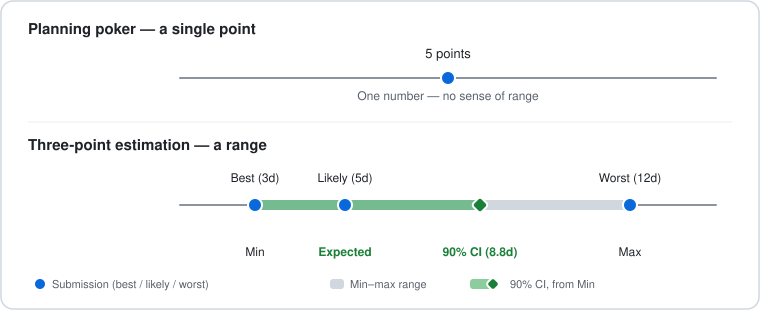
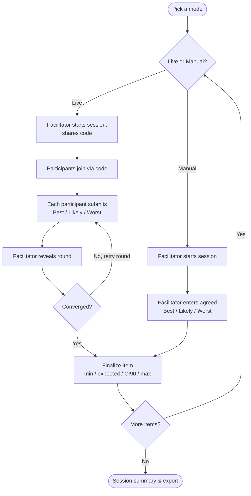

# PRD: EstiMate — Live Three-Point Estimation for Dev Teams

**Status:** Draft v1
**Author:** Christian Fischer
**Based on:** Developer's Guide to Software Estimation (agiledojo.de, Episodes I–III)

## 1. Problem

Most planning poker tools (Fibonacci cards) collapse estimation into a single relative number. They don't communicate uncertainty, don't produce a defensible range for stakeholders, and don't guard against the psychological traps that make software estimates unreliable (false precision, symmetric ranges, underestimated worst cases).

EstiMate applies **three-point estimation** — the method recommended in Episode III for teams without historical data or facing high uncertainty — in a live, planning-poker-style session, and outputs the four values stakeholders actually need: **minimum, expected, 90% confidence interval, maximum**.

## 2. Goals

- **Live, together, in real time** 
  A dev team estimates a backlog live, with no central server the app operator has to run
- **Manual entry** 
  A solo facilitator who ran the discussion elsewhere (in person, on a call) just types in the team's agreed numbers
- **Range over guess** 
  For each item, produce a defensible range + confidence interval instead of a single number
- **Counter the known biases** 
  Actively guard against symmetric ranges, underestimated worst case, false precision (from the source articles)
- **Shareable report** 
  Facilitators get a summary at the end of a session
- **Save and reopen** 
  A session persists so teams can come back to it for reference

## 3. Non-goals (for MVP)

- **Story point / velocity tracking (Method 1)** 
  Future phase
- **T-shirt sizing + timeline bridge (Method 3)** 
  Future phase
- **Jira/backlog tool import** 
  Future phase (manual entry only for MVP)
- **Formal accounts/orgs** 
  Beyond what's needed for session persistence (see [live-collaboration](concepts/live-collaboration.md))

## 4. Primary user & core flow

**Primary user:** dev teams doing estimation together (e.g., during backlog refinement or project kickoff), plus a facilitator running the session. This flow plays out across the screens detailed in [screen-flow](concepts/screen-flow.md).

| Role | Live mode | Manual mode |
|---|---|---|
| **Facilitator** | Starts the session, shares the code, reveals rounds, finalizes items, gets the report | Starts the session, enters all values directly, finalizes items, gets the report |
| **Participant** | Joins via code, privately submits Best / Likely / Worst each round | Not used — the facilitator is the only input source |

### 4.1 Session modes

On the entry screen, before any session setup, the facilitator picks one of two modes. Both modes produce the same output (items with min/expected/CI90/max) and share the same summary/report/save-and-load features — only how the numbers get in differs. See **ADR-001** for the reasoning behind offering both, and
[live-collaboration](concepts/live-collaboration.md) for the full process, information
model, and rules of both modes.

### 4.2 Mode comparison

| | Live mode (Mode A) | Manual mode (Mode B) |
|---|---|---|
| Who submits | Each participant, from their own device | Facilitator only |
| Real-time sync needed | Yes (peer-to-peer) | No |
| Per-participant outlier view | Yes | No (single set of values) |
| Best for | Distributed team estimating together live | Facilitator recording a discussion that already happened |
| Network dependency | Requires peers to connect (see ADR-001) | None |

## 5. Estimation Model

Three-point estimation turns best/likely/worst submissions into a defensible range and a
90% confidence interval (McConnell's formula, Episode III), guarded by bias-detecting
nudges (symmetric range, false precision, outlier, uncertainty range — Tips #4–9) that
are what make this more than a poker clone. Full process, information model, and guard
table: [estimation-method](concepts/estimation-method.md).

## 6. Non-functional requirements

- **Real-time sync** *(Mode A only)* 
  Submissions and reveals sync live across participants via **peer-to-peer WebRTC connections, using public STUN servers for NAT traversal and serverless signaling** — no backend operated by the app for session communication (full reasoning in **ADR-001**)
- **No-account joining** *(Mode A)* 
  Participants join with just a name; only the session creator/team needs persistent identity for saving and reopening sessions
- **Graceful degradation** *(Mode A)* 
  If a peer connection can't be established, the app surfaces this clearly rather than failing silently, and points the facilitator toward Mode B as a fallback for that session
- **Session persistence** 
  Sessions and their reports are saved and retrievable later by the team, regardless of mode
- **Export** 
  Session summary exportable as CSV and/or shareable read-only link

## 7. Open questions

- **Re-estimate visualization** 
  How should re-estimate rounds be visualized in the final report — show convergence over rounds, or just the final round?
- **Override/reconcile** 
  Should facilitators be able to override/reconcile the auto-calculated group range manually before finalizing an item?
- **Minimum viable auth** 
  Magic-link/email for session creators only, or fully open workspace links?
- **Mode switch mid-session** 
  Can a session be switched from Mode A to Mode B mid-session (e.g., after a connection fallback on one item), or is mode fixed at creation?
- **Manual-mode multi-entry** 
  Should Mode B support multiple named entries per item (e.g., facilitator typing in what each person said) rather than a single reconciled value — closer to Mode A's data shape without the live connection?

## 8. Future phases (post-MVP)

- **Phase 2** 
  Story Point + velocity tracking (Method 1) — teams with stable history skip live three-point sessions and use velocity-derived ranges instead
- **Phase 3** 
  T-shirt sizing for epics with bridge-to-three-point workflow (Method 3)
- **Phase 4** 
  Backlog tool import (Jira, Linear, etc.)

Cone-of-uncertainty guidance (§5) shipped as part of the MVP guard set, not a future phase — moved out of this list accordingly.

## 9. Related decisions

- **ADR-001: Peer-to-peer (STUN-assisted) architecture for live collaboration, with manual entry as a first-class fallback mode** — see accompanying ADR document

## 10. Executable specs

Scenarios that pin down this PRD's behaviour as acceptance criteria live as executable
Gherkin specs under `specs/<concept>/<test level>/` (ADR-010), not as prose here — a
`.feature` file fails loudly when the app stops matching it, where a sentence in this
document could silently drift. See [live-collaboration](concepts/live-collaboration.md)
and [estimation-method](concepts/estimation-method.md) for which scenarios exist today.
