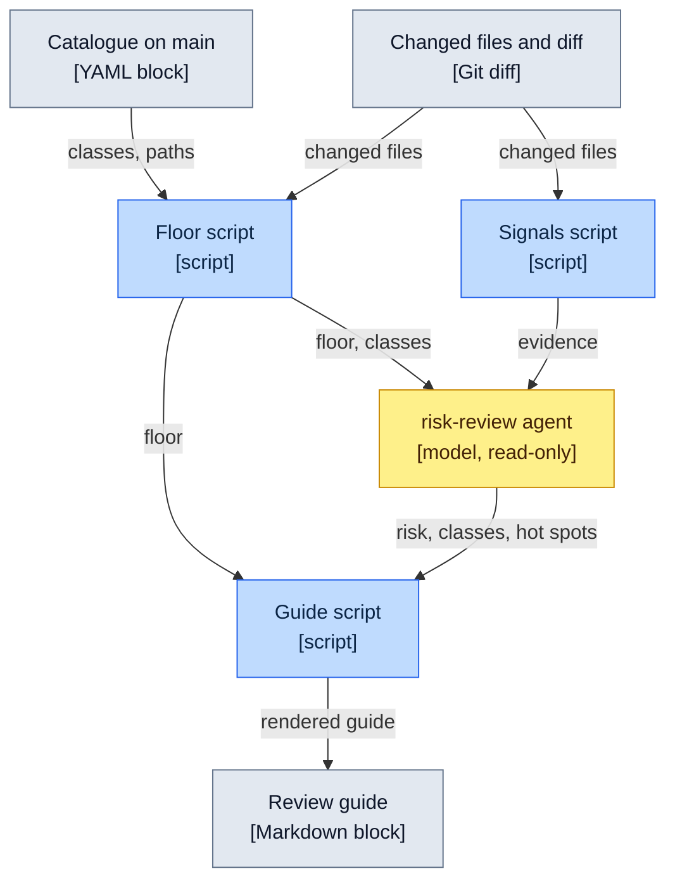

# Review risk catalogue

The named classes of change that deserve a closer look in a pull request, and the minimum risk
each one carries. Each class has a short name so that a review guide, a review or a discussion
can cite it ("this is `wire-contract`"). The words follow the [glossary](glossary.md).

The catalogue exists because a reader of an agent's pull request should know where to spend
attention. A model can judge a diff, but its worst mistake is calling a dangerous change low
risk. So the rules below set a **floor** by path patterns and diff checks, and the model may only raise the
risk above it.

Status: the floor script, the `risk-review` agent and the review guide are planned and not in the
repository yet. Until they land, this file is read by people only, and the next section describes
the intended use. Remove this note when the tooling lands.

## How it is used (intended)

Legend: solid line = data passed on. Scripts are deterministic; the agent is the only model step.



| Step | Role |
|---|---|
| **Floor script** | Reads the YAML block below from `main` (never from the pull request being checked), matches the changed files against it and reports the matched classes and the highest minimum risk. |
| **Signals script** | Gathers evidence for the agent: git history, changed-line coverage, the dependency diff. A signal may be missing and never sets a class. |
| **`risk-review` agent** | Receives the floor and the evidence. It may raise the risk, add classes and name hot spots. It may never go below the floor. |
| **Guide script** | Takes the higher of the floor and the agent's risk, drops hot spots for files not in the diff and renders the guide, using the class names from this file. |

## Risk levels

| Level | Meaning |
|---|---|
| `low` | A mistake is easy to see and easy to revert |
| `medium` | A mistake can slip through review or tests but has a narrow effect |
| `high` | A mistake can break behaviour that tests and the type checker do not cover, or weakens a check |
| `critical` | A mistake is hard to reverse once shipped. No class uses it by default; the agent may raise a change to it |

## Catalogue data

The one fenced `yaml` block in this file is the data the floor script reads. Every entry has:

- `name`: the class name, unique, kebab-case.
- `min-risk`: one of the levels above.
- `paths`: glob patterns, relative to the repository root. A file matches if any pattern matches.
- `diff-checks`: names from the fixed set in [Diff checks](#diff-checks). May be empty.
- `fallback`: optional, `true` for the class that applies only when nothing else matched.

A class matches when any changed file matches one of its `paths` or any of its `diff-checks` is true.

An unknown key, a missing `min-risk` or an unknown diff-check name is an error.

```yaml
- name: domain-math
  min-risk: high
  paths: ['src/domain/**']
  diff-checks: []

- name: live-session-state
  min-risk: high
  paths:
    - 'src/application/stores/**'
    - 'src/application/useCases/**'
    - 'src/application/ports/**'
    - 'src/adapters/network/session*.ts'
    - 'src/adapters/network/connection*.ts'
    - 'src/adapters/network/signaling.ts'
    - 'src/adapters/network/signaling.wsRelay.ts'
  diff-checks: []

- name: wire-contract
  min-risk: high
  paths:
    - 'src/adapters/network/wireParse*.ts'
    - 'src/adapters/network/actions*.ts'
    - 'src/adapters/network/signalingContract.ts'
    - 'src/domain/snapshot*.ts'
  diff-checks: []

- name: guardrail-weakened
  min-risk: high
  paths:
    - 'tsconfig*.json'
    - 'vite.config.ts'
    - 'playwright.config.ts'
    - '.oxlintrc*.json'
    - 'steiger.config.ts'
    - '.dependency-cruiser.cjs'
    - 'knip.json'
    - '.prettierrc.json'
    - 'src/design/nocturne.css'
    - 'src/viMockPaths.test.ts'
    - 'scripts/layerRules.test.ts'
    - 'AGENTS.md'
    - '.claude/hooks/**'
    - '.claude/settings.json'
    - '.claude/agents/**'
    - '.claude/skills/**'
    - '.claude/commands/**'
    - '.githooks/**'
    - 'docs/architecture-rules.md'
    - 'docs/review-risk.md'
  diff-checks: [coverageThresholdLowered, testsRemovedOrSkipped, strictnessLoosened]

- name: release-and-deploy
  min-risk: high
  paths:
    - '.github/workflows/**'
    - '.github/actions/**'
    - 'release-please-config.json'
    - '.release-please-manifest.json'
    - 'docs/runbook.md'
  diff-checks: []

- name: dependencies
  min-risk: medium
  paths: ['pnpm-lock.yaml']
  diff-checks: [dependencyFieldsChanged]

- name: mechanical
  min-risk: low
  fallback: true
  paths: ['docs/**', '**/*.md']
  diff-checks: [pureRename]
```

## Why each class exists

| Class | Why it matters here |
|---|---|
| `domain-math` | The estimation rules (aggregation, the `Estimate` invariant, bias guards) produce plausible numbers when they are wrong. Nothing crashes, and the domain keeps 100% coverage so a gap in tests is itself a warning sign (`pure-domain`). |
| `live-session-state` | Who owns the round, what a reconnect restores and when a submission is acknowledged are easy to break without a visible error. They follow [ADR-003](adr/003-session-reliability-model.md) and the store split in [ADR-005](adr/005-session-store-decomposition.md). The class covers the stores, the use cases, the ports and the adapters that hold per-connection state. |
| `wire-contract` | Peers may run different builds, so a change to what is sent or accepted between them must stay compatible. This is the repository's one-way door: once a build is out, its messages cannot be recalled. It covers peer message parsing, the action definitions, the signaling contract and the session snapshot that the facilitator sends. The snapshot files are in `src/domain`, so they match `domain-math` as well. |
| `guardrail-weakened` | A change that loosens a check makes every later change less safe: type strictness, lint and architecture rules, coverage thresholds, removed or skipped tests, the verbatim design-system stylesheet, and the instructions and hooks that guide the agents. The catalogue and the architecture rules are in this class too, so a change cannot lower its own floor without being flagged. |
| `release-and-deploy` | Merging to `main` ships to production. Workflows, release configuration and the runbook decide what ships and how. |
| `dependencies` | Supply chain, bundle size and behaviour drift. Any change to the lockfile or to the dependency fields of `package.json` counts; the version bump of the package itself, written by the release tooling, does not. |
| `mechanical` | Documentation changes and pure renames. Skim only. |

## Diff checks

A diff check is a check on the diff that a path pattern cannot express. The set is fixed so that the
floor script can check each one without judgment. Adding a diff check means adding it to the script
and to this table.
A diff check is not a signal: it sets the floor and is always deterministic, while a signal is
evidence for the agent that may be missing and never sets a class.

| Diff check | True when |
|---|---|
| `coverageThresholdLowered` | A coverage threshold number in `vite.config.ts` went down or was removed |
| `testsRemovedOrSkipped` | A test file was deleted, or `.skip`, `.only`, `xit` or `xdescribe` was added to a test |
| `strictnessLoosened` | A strict flag in a `tsconfig` file was turned off or removed |
| `dependencyFieldsChanged` | The `dependencies`, `devDependencies`, `peerDependencies`, `optionalDependencies` or `overrides` of `package.json` changed |
| `pureRename` | Git reports a file as renamed with 100% similarity |

## Matching rules

1. A file can match several classes. A test file matches the class of the file it tests: same
   directory, same name with `.test` before the extension (`signaling.test.ts` for
   `signaling.ts`). A change to a test is not hidden from the review. This rule only adds
   matches; a test file listed in a class's `paths` matches that class either way.
2. The floor is the highest `min-risk` among the matched classes.
3. The `fallback` class applies only when no other class matched and every changed file matches
   its paths or is a pure rename. A rename of a file that matches another class keeps that
   class, so `pureRename` never lowers the floor of the renamed file.
4. A change that matches no class has the floor `low`. The agent still assesses it and may raise
   it.
5. A change to this file is `guardrail-weakened` by rule, because the file lists itself.

## Changing the catalogue

Add or change a class in a pull request, and explain the reason in the description. Because the
floor script reads the catalogue from `main`, a change applies to later pull requests only.
Keep the prose in "Why each class exists" and the YAML block in step with each other; the block
is the only place that lists paths, so nothing else has to be updated.
