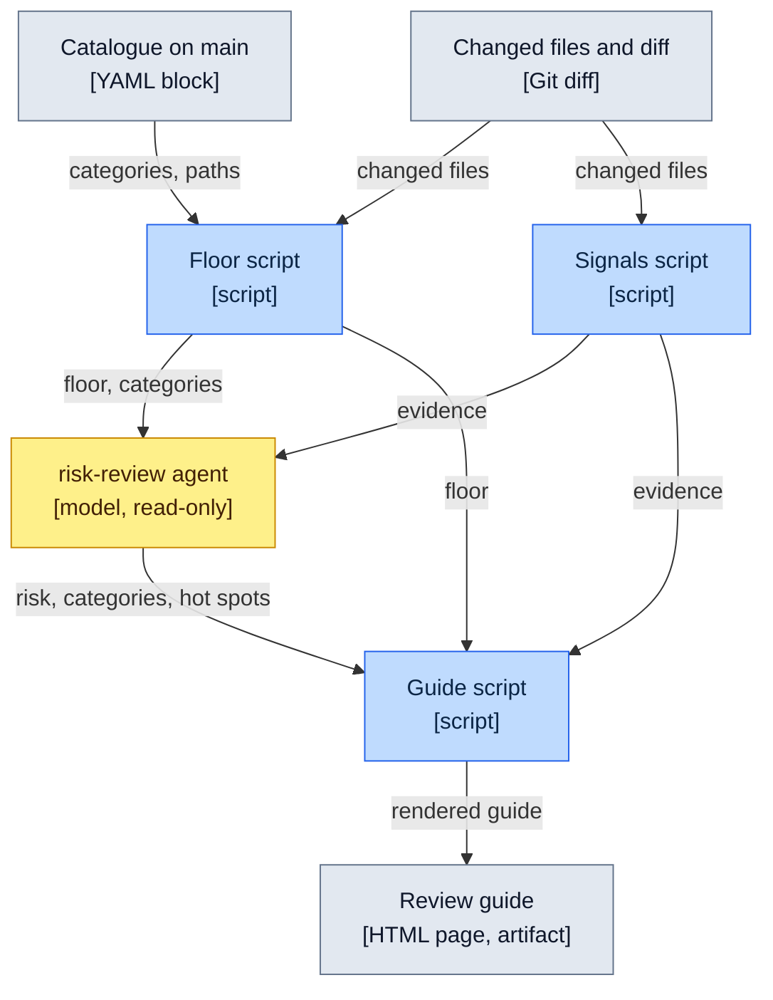

# Review risk catalogue

The named categories of change that deserve a closer look when reviewing a branch, and the minimum risk
each one carries. Each category has a short name so that a review guide, a review or a discussion
can cite it ("this is `wire-contract`"). The words follow the [glossary](glossary.md).

The catalogue exists because a reader of an agent's pull request should know where to spend
attention. A model can judge a diff, but its worst mistake is calling a dangerous change low
risk. So the rules below set a **floor** by path patterns and diff checks, and the model may only raise the
risk above it.

## How it is used

`/risk-review` runs this flow when the maintainer reviews a branch; only the floor script runs
when a PR opens. The guide describes the commit it names: run the command again after new commits.

Legend: solid line = data passed on. Scripts are deterministic; the agent is the only model step.



| Step | Role |
|---|---|
| **Floor script** | Reads the YAML block below from the base branch (`origin/main`, else `main`; never from the pull request being checked, also when given a commit to start from), matches the changed files against it and reports the matched categories and the highest minimum risk. |
| **Signals script** | Gathers evidence for the agent: git history (changes and `fix:` commits per file over the last six months, the ten files with most fixes first), the `pnpm metrics` hotspots, changed-line coverage (it runs the unit tests itself, within two minutes) and the dependency diff with the `pnpm audit` advisories that hit a version the change added (audit needs network access). It prints `history`, `metrics`, `coverage` and `dependencies`. A section that cannot run says "not available". A signal may be missing and never sets a category. |
| **`risk-review` agent** | Receives the floor and the evidence. It may raise the risk, add categories and name hot spots. It may never go below the floor. |
| **Guide script** | Takes the higher of the floor and the agent's risk, keeps the floor's categories plus the catalogue names the agent added, drops hot spots that are not a changed line, adds the signal facts to the hot spots, turns the rest of the signals into the "Not verified" section and renders the guide page. |

## The agent's answer

The `risk-review` agent replies with one JSON object, which the guide script reads. The agent
runs both scripts itself, and a signal never makes a category or a hot spot on its own.

| Field | Content |
|---|---|
| `risk` | A [risk level](#risk-levels), at least the floor |
| `categories` | Names from the catalogue, including every category the floor found |
| `hotSpots` | Up to eight places to read closely, most important first: a `title` (a headline of about ten words), a `body` (what the change is and what makes it a hot spot), `file` and `line` (a line the change added or changed) and a `rule` (architecture rule, ADR number or catalogue category) |
| `skimOnly` | Files that can be skimmed, each with a `why` |
| `notVerified` | What a reader has to check by hand because the agent could not or did not: concrete, short, possibly empty |

## The review guide

The guide is built on request, when the maintainer reviews a branch: `/risk-review` runs the
scripts and the agent and publishes the result as a private artifact. The pull request body
carries no guide. `pnpm review:guide` turns the floor, the signals and the agent's answer into one
self-contained HTML page. A script writes it, so the rules hold whatever the agent says:

- The risk is the higher of the floor and the agent's risk. A lower answer is ignored and noted
  under "Checked by the scripts".
- Categories are the floor's plus the catalogue names the agent added. Other names are dropped.
- A hot spot must be a line the change added or changed, up to eight. Others are dropped and
  noted. The floor script supplies the changed lines. Agent text is escaped, so it cannot add
  markup to the page.
- Each hot spot carries facts that the script adds from the signals, never the agent: "No test
  runs this line" when the changed-line coverage lists the line, and the number of `fix:` commits
  of the file in the last six months when it is two or more (the history signal lists only the
  ten files with the most fixes, so a file further down gets no fact). A line that coverage does not list
  may be covered or have no statement, so nothing is said about it.
- "Not verified" lists what a reader has to check by hand: the signals that could not run or have
  no data for a file, a warning when the script dropped hot spots or showed only eight of more
  (the guide then lacks content), then the agent's `notVerified` entries. What the scripts did measure, and
  what the script itself dropped or overrode, sits in a collapsed "Checked by the scripts" block
  below it.
- A hot spot links to its file and line at the commit the guide covers when the repository has a
  GitHub address (read from the `origin` remote); otherwise the reference is plain text.
- The page describes the commit it names. After new commits, run the command again; it
  publishes over the earlier artifact of the same pull request and nothing compares the two.

| Part | Content |
|---|---|
| Marker | `Covers <commit>`, the commit the guide was written for, so a reader can see what it describes |
| Risk | The level and the category names |
| Hot spots | A headline, what the change is and what makes it a hot spot, the reference (`file:line`, linked to the covered commit) with the rule or ADR, and facts from the signals |
| Skim only | Files a reader can skim, each with a reason |
| Not verified | What a reader has to check by hand; the scripts' own findings are folded below it |

Do not edit the page by hand; run the command again.

When a pull request opens, the agent reports the minimum risk and categories first in its answer. A `PostToolUse` hook on `gh pr create`
(`.claude/hooks/posttooluse-floor.sh`) also shows the floor to the maintainer, so the report does not
depend on the agent. That costs seconds and no model, and it is the only automatic signal: the
guide itself exists only when the maintainer asks for it.

## Risk levels

| Level | Meaning |
|---|---|
| `low` | A mistake is easy to see and easy to revert |
| `medium` | A mistake can slip through review or tests but has a narrow effect |
| `high` | A mistake can break behaviour that tests and the type checker do not cover, or weakens a check |
| `critical` | A mistake is hard to reverse once shipped. No category uses it by default; the agent may raise a change to it |

## Catalogue data

The one fenced `yaml` block in this file is the data the floor script reads. Every entry has:

- `name`: the category name, unique, kebab-case.
- `min-risk`: one of the levels above.
- `paths`: glob patterns, relative to the repository root. A file matches if any pattern matches.
- `diff-checks`: names from the fixed set in [Diff checks](#diff-checks). May be empty.
- `fallback`: optional, `true` for the category that applies only when nothing else matched.

A category matches when any changed file matches one of its `paths` or any of its `diff-checks` is true.

Any malformed entry is an error: an unknown key, a missing `min-risk`, an unknown diff-check name,
a duplicate `name`, more than one `fallback`, and so on.

```yaml
- name: domain-math
  min-risk: high
  paths: ['src/domain/**']
  diff-checks: []

- name: live-session-state
  min-risk: high
  paths:
    - 'src/application/stores/**'
    - 'src/application/useCases/**'
    - 'src/application/ports/**'
    - 'src/adapters/network/session*.ts'
    - 'src/adapters/network/connection*.ts'
    - 'src/adapters/network/signaling.ts'
    - 'src/adapters/network/signaling.wsRelay.ts'
  diff-checks: []

- name: wire-contract
  min-risk: high
  paths:
    - 'src/adapters/network/wireParse*.ts'
    - 'src/adapters/network/actions*.ts'
    - 'src/adapters/network/signalingContract.ts'
    - 'src/domain/snapshot*.ts'
  diff-checks: []

- name: guardrail-weakened
  min-risk: high
  paths:
    - 'tsconfig*.json'
    - 'vite.config.ts'
    - 'playwright.config.ts'
    - '.oxlintrc*.json'
    - 'steiger.config.ts'
    - '.dependency-cruiser.cjs'
    - 'knip.json'
    - '.prettierrc.json'
    - 'src/design/nocturne.css'
    - 'src/viMockPaths.test.ts'
    - 'scripts/layerRules.test.ts'
    - 'AGENTS.md'
    - '.claude/hooks/**'
    - '.claude/settings.json'
    - '.claude/agents/**'
    - '.claude/skills/**'
    - '.claude/commands/**'
    - '.githooks/**'
    - 'scripts/review*.ts'
    - 'scripts/changedDiff.ts'
    - 'docs/architecture-rules.md'
    - 'docs/review-risk.md'
  diff-checks: [coverageThresholdLowered, testsRemovedOrSkipped, strictnessLoosened]

- name: release-and-deploy
  min-risk: high
  paths:
    - '.github/workflows/**'
    - '.github/actions/**'
    - 'release-please-config.json'
    - '.release-please-manifest.json'
    - 'docs/runbook.md'
  diff-checks: []

- name: dependencies
  min-risk: medium
  paths: ['pnpm-lock.yaml']
  diff-checks: [dependencyFieldsChanged]

- name: mechanical
  min-risk: low
  fallback: true
  paths: ['docs/**', '**/*.md']
  diff-checks: [pureRename]
```

## Why each category exists

| Category | Why it matters here |
|---|---|
| `domain-math` | The estimation rules (aggregation, the `Estimate` invariant, bias guards) produce plausible numbers when they are wrong. Nothing crashes, and the domain keeps 100% coverage so a gap in tests is itself a warning sign (`pure-domain`). |
| `live-session-state` | Who owns the round, what a reconnect restores and when a submission is acknowledged are easy to break without a visible error. They follow [ADR-003](adr/003-session-reliability-model.md) and the store split in [ADR-005](adr/005-session-store-decomposition.md). The category covers the stores, the use cases, the ports and the adapters that hold per-connection state. |
| `wire-contract` | Peers may run different builds, so a change to what is sent or accepted between them must stay compatible. This is the repository's one-way door: once a build is out, its messages cannot be recalled. It covers peer message parsing, the action definitions, the signaling contract and the session snapshot that the facilitator sends. The snapshot files are in `src/domain`, so they match `domain-math` as well. |
| `guardrail-weakened` | A change that loosens a check makes every later change less safe: type strictness, lint and architecture rules, coverage thresholds, removed or skipped tests, the verbatim design-system stylesheet, and the instructions and hooks that guide the agents. The catalogue and the architecture rules are in this category too, so a change cannot lower its own floor without being flagged. |
| `release-and-deploy` | Merging to `main` ships to production. Workflows, release configuration and the runbook decide what ships and how. |
| `dependencies` | Supply chain, bundle size and behaviour drift. Any change to the lockfile or to the dependency fields of `package.json` counts; the version bump of the package itself, written by the release tooling, does not. |
| `mechanical` | Documentation changes and pure renames. Skim only. |

## Diff checks

A diff check is a check on the diff that a path pattern cannot express. The set is fixed so that the
floor script can check each one without judgment. Adding a diff check means adding it to the script
and to this table.
A diff check is not a signal: it sets the floor and is always deterministic, while a signal is
evidence for the agent that may be missing and never sets a category.

| Diff check | True when |
|---|---|
| `coverageThresholdLowered` | A coverage threshold number in `vite.config.ts` went down or was removed |
| `testsRemovedOrSkipped` | A test file was deleted, or `.skip`, `.only`, `xit` or `xdescribe` was added to a test |
| `strictnessLoosened` | A strict flag in a `tsconfig` file was turned off or removed |
| `dependencyFieldsChanged` | The `dependencies`, `devDependencies`, `peerDependencies`, `optionalDependencies` or `overrides` of `package.json` changed |
| `pureRename` | Git reports a file as renamed with 100% similarity |

## Matching rules

1. A file can match several categories. A test file matches the category of the file it tests: same
   directory, same name with `.test` before the extension (`signaling.test.ts` for
   `signaling.ts`). A change to a test is not hidden from the review. This rule only adds
   matches; a test file listed in a category's `paths` matches that category either way.
2. The floor is the highest `min-risk` among the matched categories.
3. The `fallback` category applies only when no other category matched and every changed file matches
   its paths or is a pure rename. A rename of a file that matches another category keeps that
   category, so `pureRename` never lowers the floor of the renamed file.
4. A change that matches no category has the floor `low`. The agent still assesses it and may raise
   it.
5. A change to this file is `guardrail-weakened` by rule, because the file lists itself.

## Changing the catalogue

Add or change a category in a pull request, and explain the reason in the description. Because the
floor script reads the catalogue from `main`, a change applies to later pull requests only.
Keep the prose in "Why each category exists" and the YAML block in step with each other; the block
is the only place that lists paths, so nothing else has to be updated.
