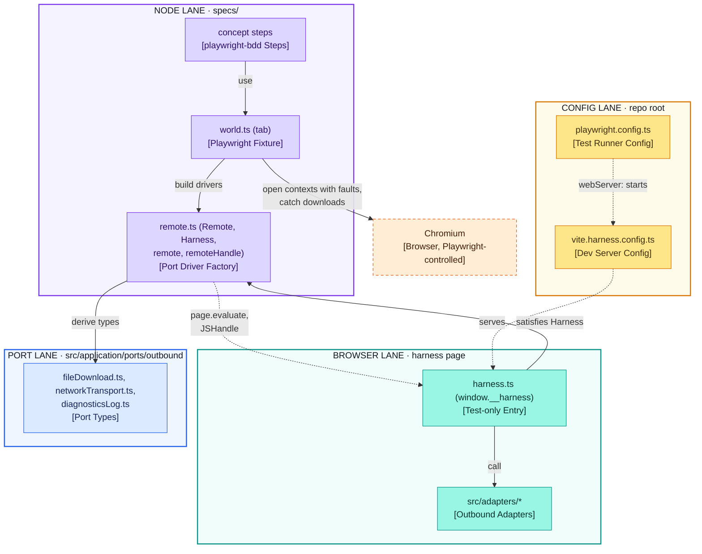
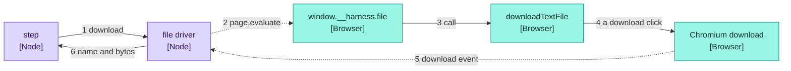
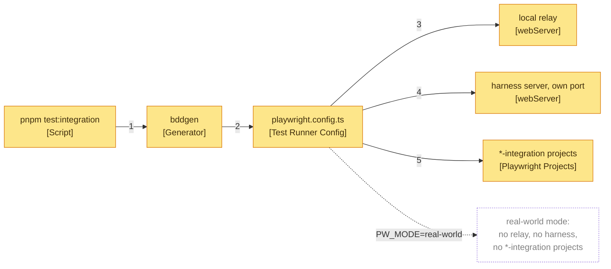

# Integration Testing — Technical Concept

## Overview

The `integration` Test Level drives each outbound adapter through the port the application
owns, in a real browser, against the real external system the adapter wraps. Scenarios
live in `specs/<concept>/integration/*.feature`; the shared driver code lives in
`specs/shared/integration/`. Steps run in Node; the adapters run on a test-only harness
page, and every call crosses `page.evaluate`, or a `JSHandle` for an object that stays in
the page.

This doc covers what exists and how it's wired. [ADR-011](../adr/011-integration-test-level.md)
is the decision record: why a real browser, why Playwright, why port drivers derived from
ports. The `e2e` Test Level, which drives the real UI, is covered in
[e2e-testing.md](e2e-testing.md).

## Component view

Structural only; the two flows below show the order. Lines: **solid** = import/call,
**dotted** = config-time wiring or a call across the Node/browser boundary.

| Component | Responsibility |
|---|---|
| Concept steps | Gherkin step definitions for one concept, calling port drivers only, never `page.evaluate` |
| `world.ts` | The `tab(browser, tab, options)` fixture: one browser context per browser name, one page per tab, opened on the harness page once `window.__harness` is installed; builds the port drivers for a tab. A browser's options set its faults when its first tab opens; a tab can also move its page's clock forward (`moveClockForward`) |
| `remote.ts` | `Remote<Port>`, the type of a port as seen from Node (every operation async, `on…` callbacks left out); `Harness`, what `window.__harness` holds; `remote()`, the generic forwarder to a harness entry, and `remoteHandle()`, the same forwarder to an object that stays in the page |
| `harness.ts` | Imports the real adapters, composed as `App.tsx` composes them (the network adapter records into the page's diagnostics log), and installs `window.__harness`, declared `satisfies Harness` |
| `vite.harness.config.ts` | Serves the harness page with Vite's mode set to `e2e`, so the network adapter picks the local relay ([ADR-007](../adr/007-e2e-dual-mode-signaling.md)). Pre-bundles Trystero: found only on first load, it would make Vite re-optimise and reload the page under a running scenario |
| `playwright.config.ts` | Starts the harness server (local mode only, never reused, `--strictPort`, so a busy port fails the run) and runs the `*-integration` projects with the harness as `baseURL` |

## One step call

How a download step reaches the file adapter and gets back what the browser saved.
Numbered edges give the order; dotted = across the Node/browser boundary.

1. **Step** 
   The step calls the file driver with the port's own arguments (name, text, content
   type).
2. **Across the boundary** 
   `remote()` sends the call through `page.evaluate` to `window.__harness.file`. If the
   harness page didn't install that entry, the call fails with a message naming it.
3. **Adapter** 
   The harness entry is the real `downloadTextFile`.
4. **Browser** 
   The adapter hands Chromium a Blob through a download link.
5. **Download event** 
   The file driver waited for Playwright's `download` event since step 2.
6. **Result** 
   It returns the suggested file name and the saved bytes; the step compares bytes, not
   decoded text.

## Run flow

What `pnpm test:integration` (or `pnpm test:e2e`) starts. The dashed node is the branch
real-world mode skips.

| Command | Runs |
|---|---|
| `pnpm test:integration` | `bddgen`, then the `*-integration` projects only |
| `pnpm test:specs` | Every Gherkin spec: the `domain` Test Level, then every `*-bdd` and `*-integration` project |
| `pnpm test:e2e` | Every Playwright project, so CI's `e2e` job covers this Test Level too |

## Port drivers follow the ports

A port driver is never written by hand. `remote(page, entry)` takes its type from the
harness entry's port, and forwards any operation to `window.__harness[entry]`. Because the
harness object is declared `satisfies Harness`, renaming or removing a port operation, or
changing a parameter's type, fails `pnpm typecheck` both in the harness and in every step
that uses it. A parameter added to the port is the one exception the harness side doesn't
catch, because TypeScript accepts a function with fewer parameters: when a port gains a
parameter, update its adapter in the same change.

The one partly hand-written driver is the file driver: its parameters come from the port,
but it also waits for Playwright's `download` event and returns the saved file's name and
bytes.

**A port that returns a session.** The network port, `JoinSession`, is a function that
returns a `TransportSession`, an object full of functions that can't cross into Node. Its
harness entry is `{ join }`. The network driver calls it with `page.evaluateHandle`, which
keeps the session in the page and hands Node a typed `JSHandle<TransportSession>`;
`remoteHandle()` turns that handle into a driver whose operations are typed from
`TransportSession`, so it follows the port like any other.

## Adding a port

1. **Harness type** 
   Add an entry to `Harness` in `remote.ts`: `<name>: HarnessEntry<SomePort>`.
2. **Harness page** 
   Install the real adapter under that name in `harness.ts`. The import rules allow
   `src/adapters`, `src/application/ports/outbound` and `src/domain` only.
3. **Driver** 
   Build it in `world.ts` with `remote(page, '<name>')`; its type follows from the entry.
4. **A session-returning port** 
   If the port is a function that returns an object, follow
   [A port that returns a session](#port-drivers-follow-the-ports) above.
5. **Callbacks** 
   A port's `on…` callbacks can't reach Node. Where an adapter records what it sees, steps
   wait on that record instead: the network scenarios poll the diagnostics log with
   `expect.poll`. The first scenario that needs a port callback itself also builds the
   in-page journal: the harness subscribes to each callback and appends it to the journal,
   and steps read the journal and wait on it.

## Adding a fault

Inject a fault only through the browser or Playwright (for example `context.setOffline`,
or an init script that makes `localStorage.setItem` throw), or through a real configuration
the adapter honours anyway. Never stub adapter internals or Trystero, and add a fault only
when a scenario needs it.

| Fault | How | Set by |
|---|---|---|
| **No direct connections** | A separately launched Chromium with `--force-webrtc-ip-handling-policy=disable_non_proxied_udp`: it offers no candidates, so a WebRTC attempt with it can't connect | `{ directConnections: false }` |
| **Storage refuses writes** | An init script on the browser context that makes `Storage.prototype.setItem` throw a `QuotaExceededError` | `{ storage: 'refuses-writes' }` |
| **Time has passed** | Playwright's clock, installed on the open page and left running; `setSystemTime` moves `Date.now()` forward without firing the timers due in between, and the call fails if the page's clock didn't move | `tab.moveClockForward(ms)`, on a tab already in a session |

## Import rules

| Rule | From | May import from `src/` |
|---|---|---|
| `specs-integration-harness-imports-adapters-ports-domain` | `specs/shared/integration/harness/` | `adapters`, `application/ports/outbound`, `domain` |
| `specs-integration-type-only-src` | every other file under `specs/*/integration/` | types only |
| `specs-integration-only-port-and-domain-types` | every other file under `specs/*/integration/` | `application/ports/outbound`, `domain` |

`scripts/specRules.test.ts` plants a violation of each rule and checks that it's reported,
and that the allowed imports (a port type from a step, an adapter or a port from the
harness) pass.

Real-world mode (`PW_MODE=real-world`) leaves the `*-integration` projects out: it starts
neither the local relay nor the harness server.
