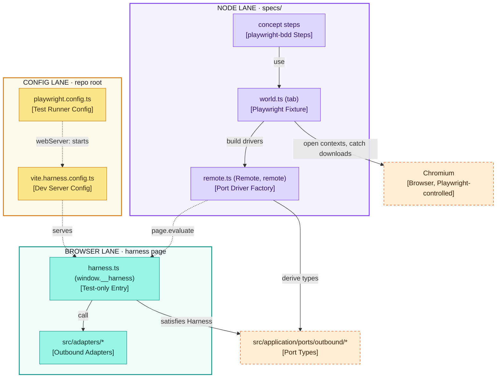

# Integration Testing — Technical Concept

## Overview

The `integration` Test Level drives each outbound adapter through the port the application
owns, in a real browser, against the real external system the adapter wraps. Scenarios
live in `specs/<concept>/integration/*.feature`; the shared driver code lives in
`specs/shared/integration/`. Steps run in Node; the adapters run on a test-only harness
page, and every call crosses `page.evaluate`.

This doc covers what exists and how it's wired. [ADR-011](../adr/011-integration-test-level.md)
is the decision record: why a real browser, why Playwright, why drivers derived from
ports. The `e2e` Test Level, which drives the real UI, is covered in
[e2e-testing.md](e2e-testing.md).

## Component view

Lines: **solid** = import/call, **dotted** = config-time wiring or a call across the
Node/browser boundary.

| Component | Responsibility |
|---|---|
| Concept steps | Gherkin step definitions for one concept, calling drivers only, never `page.evaluate` |
| `world.ts` | The `tab(browser, tab)` fixture: one browser context per browser name, one page per tab, opened on the harness page; builds the drivers for a tab |
| `remote.ts` | `Remote<Port>`, the type of a port as seen from Node (every operation async, `on…` callbacks left out); `Harness`, what `window.__harness` holds; `remote()`, the one generic forwarder |
| `harness.ts` | Imports the real adapters and installs `window.__harness`, declared `satisfies Harness` |
| `vite.harness.config.ts` | Serves the harness page in `--mode e2e`, so the network adapter picks the local relay ([ADR-007](../adr/007-e2e-dual-mode-signaling.md)) |
| `playwright.config.ts` | Starts the harness server (local mode only, `--strictPort`) and runs the `*-integration` projects with the harness as `baseURL` |

## Drivers follow the ports

A driver is never written by hand. Its type is derived from the port type, and `remote()`
forwards any operation to `window.__harness[entry]`. Because the harness object is declared
`satisfies Harness`, renaming, removing or re-typing a port operation fails
`pnpm typecheck` both in the harness and in every step that uses it.

The one partly hand-written driver is the file driver: its parameters come from the port,
but it also waits for Playwright's `download` event and returns the saved file's name and
text.

## Adding a port

1. **Harness type** 
   Add an entry to `Harness` in `remote.ts`: `<name>: HarnessEntry<SomePort>`.
2. **Harness page** 
   Install the real adapter under that name in `harness.ts`. The import rules allow
   `src/adapters`, `src/application/ports` and `src/domain` only.
3. **Driver** 
   Build it in `world.ts` with `remote<SomePort>(page, '<name>')`.
4. **Callbacks** 
   If the port has `on…` callbacks, the harness subscribes to each one and appends it to
   an in-page journal. Steps read the journal and wait on it with `expect.poll`. No port
   with callbacks is wired yet.

## Adding a fault

Inject a fault only through the browser or Playwright (for example `context.setOffline`,
or an init script that makes `localStorage.setItem` throw), or through a real configuration
the adapter honours anyway. Never stub adapter internals or Trystero, and add a fault only
when a scenario needs it.

## Import rules

| Rule | From | May import from `src/` |
|---|---|---|
| `specs-integration-harness-imports-adapters-ports-domain` | `specs/shared/integration/harness/` | `adapters`, `application/ports`, `domain` |
| `specs-integration-type-only-src` | every other file under `specs/*/integration/` | types only |

`scripts/specRules.test.ts` plants a violation of each rule and checks that it's reported,
and that a type-only import passes.

## Running

- `pnpm test:integration` runs the `*-integration` projects only.
- `pnpm test:specs` runs every Gherkin spec, this Test Level included.
- `pnpm test:e2e` runs every Playwright project, so CI's `e2e` job covers this Test Level
  too.
- Real-world mode (`PW_MODE=real-world`) leaves the `*-integration` projects out: it starts
  neither the local relay nor the harness server.
