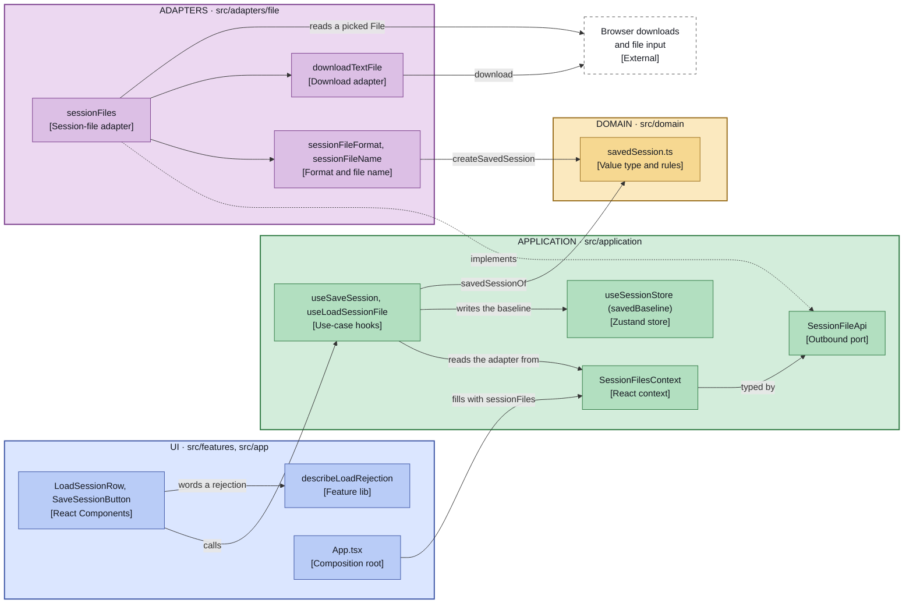
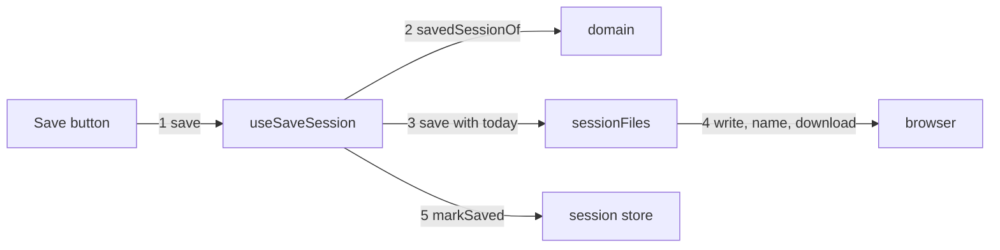
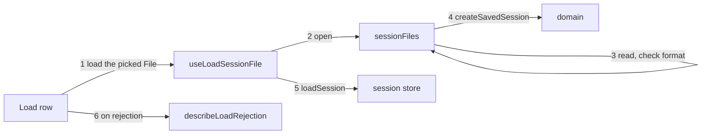

# Session Persistence — Technical Concept

Implements the process and rules described in
[session-persistence](../../domain/concepts/session-persistence.md) (domain concept): how a
saved session is written to a file, how a picked file becomes a session again, and where
each part lives.

The domain holds the saved session and its rules. The file format, the file name and the
browser I/O are an adapter behind one outbound port, `SessionFileApi`. A picked file is
untrusted input, like a peer message: it becomes a `SavedSession` only through the
domain's factory.

## Component view

Structural only; the two flows below show the order. Lines: **solid** = import/call,
**dotted** = implements.



| Component | Responsibility |
|---|---|
| **`savedSession.ts`** | `SavedSession` and `SavedItem`, a branded value type made only by `createSavedSession()` (untrusted input, the first broken rule as a `SavedSessionError`) or `savedSessionOf()` (the session itself, without its running round). `restoredItems()` puts each item outside any round. `hasUnsavedChanges()` compares the current session's saved form with the baseline field by field |
| **`SessionFileApi`** | The port: `save(session, savedOn)` returns the file name, `open(file)` returns the `SavedSession` or a `SessionFileRejection`. `PickedFile` (`name`, `text()`) is the port's own shape of a picked file, which a browser `File` already has |
| **`SessionFilesContext`** | Hands the adapter to the use-case hooks (see [architecture](../architecture.md), section 8, how the use cases reach the ports) |
| **`useSaveSession`** | Builds the saved session, saves it dated with today's local date, records it as the store's `savedBaseline`, returns the file name for the save announcement |
| **`useLoadSessionFile`** | Opens the picked file through the port; on success it loads the session (`loadSession`, which restores the items and makes the loaded session the baseline), otherwise it returns the rejection and changes nothing |
| **`sessionFiles`** | The adapter: writes, names and downloads on save; on open reads the file's text, turns a failed read into `unreadable`, then reads the format |
| **`sessionFileFormat`** | The version-1 format: `writeSessionFile()` and `readSessionFile()`, which checks the shape and the version, then hands the values to `createSavedSession()` and passes its refusal on unchanged |
| **`sessionFileName`** | The file name rule below |
| **`describeLoadRejection`** | One sentence per rejection code, for the load alert. A `Record` over the codes, so a new code without a sentence doesn't compile |

## Saving



1. **Save**<br>
   The header's Save button calls the use case.
2. **What a save keeps**<br>
   `savedSessionOf()` drops each item's running round.
3. **Save through the port**<br>
   The use case passes today's local date, so the adapter never reads the clock.
4. **Write and download**<br>
   The adapter writes the version-1 text, names the file and downloads it as
   `application/json`.
5. **Baseline**<br>
   The saved session becomes the store's `savedBaseline`; the returned name goes into the
   "Session saved as …" announcement.

## Opening



1. **Pick**<br>
   `LoadSessionRow` hands the picked `File` to the use case. It hands focus to the loaded
   session before loading, because the store update renders the loaded session before the
   load returns; on a rejection it withdraws that hand-off.
2. **Open through the port**
3. **Read and check the format**<br>
   A failed read (the file was moved, deleted or locked after it was picked) is
   `unreadable`. Text that isn't a version-1 session file's shape is `not-a-session-file`,
   a higher version is `newer-version`.
4. **Check the rules**<br>
   `createSavedSession()` checks the unit and every item and returns the first broken rule.
5. **Load**<br>
   Only a session that keeps every rule replaces the session; nothing changes otherwise.
6. **Say why**<br>
   The row shows the rejection's sentence and the file's name in the load alert.

## File format

Version 1, JSON, `application/json`. `writeSessionFile()` writes exactly these fields;
`readSessionFile()` accepts nothing else.

```yaml
FileShape:               # sessionFileFormat.ts
  version: number        # 1; a higher one is rejected as newer, any other as not a session file
  sessionName: string
  unit: string           # must be an EstimationUnit, checked by createSavedSession
  items: FileItem[]      # in order

FileItem:
  id: string
  title: string
  description: string
  notes: string
  finalResult: { min: number, expected: number, max: number, ci90: number } | null
```

The field rules (non-blank, unique ids, the final-result rules) are the saved session's,
in the [domain concept](../../domain/concepts/session-persistence.md#information-model).

## File name

`sessionFileName(sessionName, savedOn)`: the session name as a slug, then the local save
date, then `.estimate.json`, so saved files in one downloads folder stay apart and sort by
date per session. The slug drops accents, lowercases, and turns every run of other
characters into one hyphen; a name with nothing left becomes `estimate-session`. Example:
`Café Übersicht` saved on 12 November 2026 → `cafe-ubersicht-2026-11-12.estimate.json`.

## Rejections

| Code | Set by | Sentence the user sees |
|---|---|---|
| `unreadable` | adapter | This file couldn't be read. Pick it again. |
| `not-a-session-file` | adapter | This isn't an EstiMate session file. |
| `newer-version` | adapter | This file was saved by a newer version of EstiMate. |
| `unknown-unit` | domain | The unit "months" isn't one EstiMate can estimate in. |
| `item-without-id` | domain | Item 1 has no id. |
| `item-without-title` | domain | Item 1 has no title. |
| `duplicate-item-id` | domain | Item 2 has the same id as item 1. |
| `broken-final-result` | domain | Item 1, "Login", has a minimum of 0 or less. (the clause comes from `createAggregateResult`) |

## Specs

| Spec | Test Level | Covers |
|---|---|---|
| [saved-session](../../../specs/session-persistence/domain/saved-session.feature) | `domain` | What a save keeps, restoring whole or refusing with the item |
| [what-counts-as-unsaved](../../../specs/session-persistence/domain/what-counts-as-unsaved.feature) | `domain` | The unsaved-changes rule |
| [session-file](../../../specs/session-persistence/integration/session-file.feature) | `integration` | Reading back a saved file, a file from an earlier release, every rejection the adapter sets |
| [session-file-name](../../../specs/session-persistence/integration/session-file-name.feature) | `integration` | The file name |
| [save-and-resume](../../../specs/session-persistence/e2e/save-and-resume.feature), [unsaved-changes](../../../specs/session-persistence/e2e/unsaved-changes.feature) | `e2e` | The whole flow in the app |
