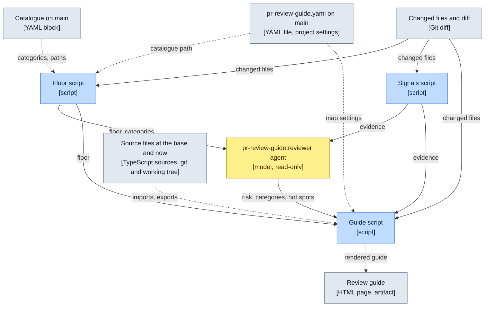
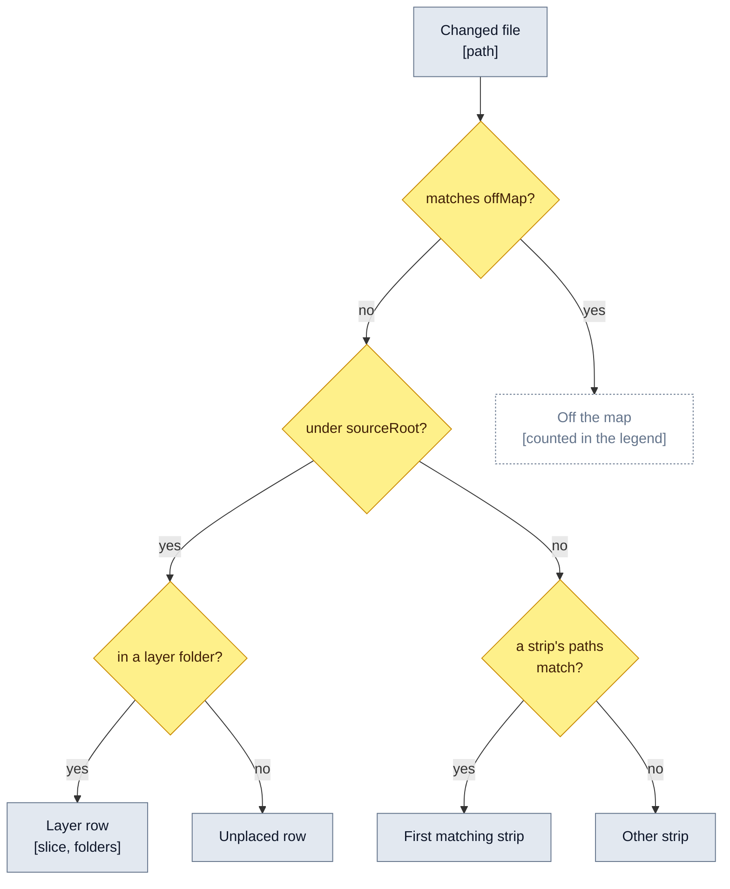
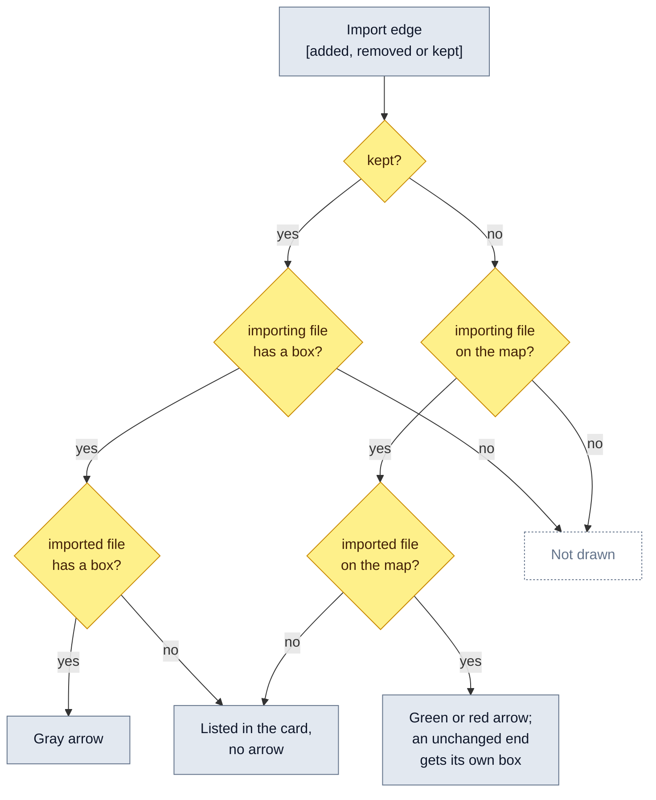
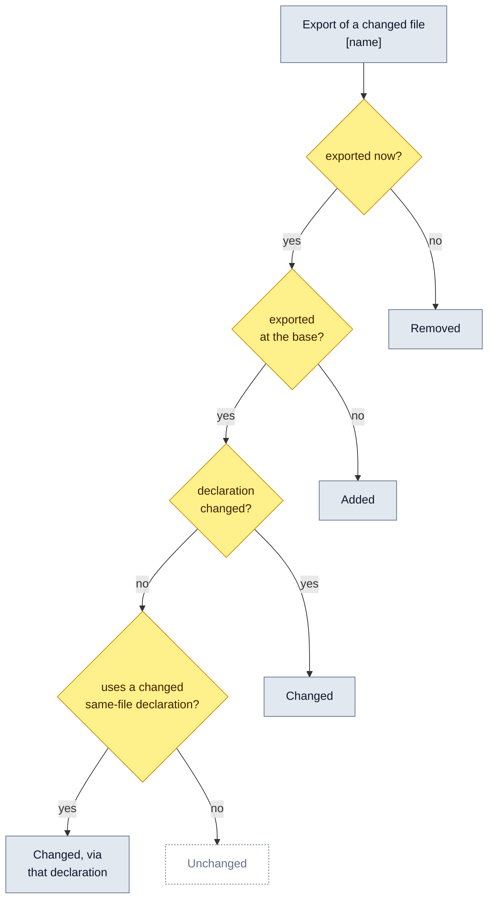
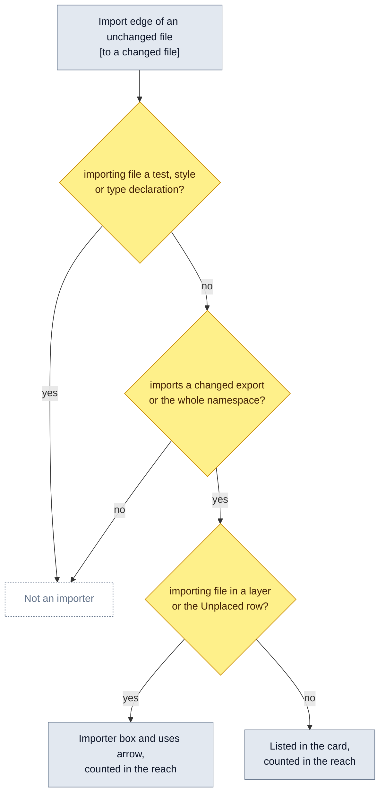
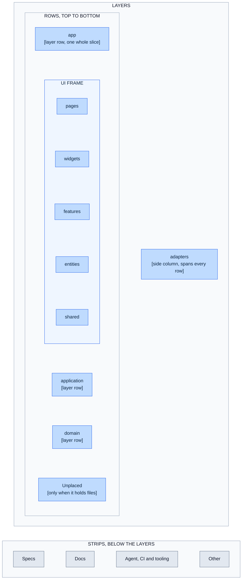
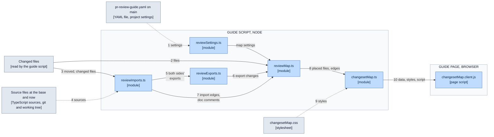

# PR review catalogue

The named categories of change that deserve a closer look when reviewing a branch, and the minimum risk
each one carries. Each category has a short name so that a review guide, a review or a discussion
can cite it ("this is `wire-contract`"). The words follow the [glossary](../glossary.md).
"PR" in the name means a pull request's branch: what is reviewed is that branch with any
uncommitted changes, also before the pull request is opened.

The catalogue exists because a reader of an agent's pull request should know where to spend
attention. A model can judge a diff, but its worst mistake is calling a dangerous change low
risk. So the rules below set a **floor** by path patterns and diff checks, and the model may only raise the
risk above it.

## How it is used

`/pr-review-guide` runs this flow when the maintainer reviews a branch; only the floor script runs
when a PR opens, through the pr-review-guide plugin's hook (without the plugin, run `pnpm review:floor`). The guide describes the commit it names: run the command again after new commits.

Legend: solid line = data passed on, dotted line = file read. Scripts are deterministic; the agent is the only model step.



| Step | Role |
|---|---|
| **Floor script** | Reads the **project settings** `pr-review-guide.yaml` from the base branch (`origin/main`, else `main`), never from the pull request being checked, also when given a commit to start from. Then reads the **catalogue** the settings name from the base branch too. Today that is this file's YAML block below, which is also the default when there is no settings file or no `catalogue` key. Settings that are malformed or name a catalogue the base branch lacks stop the floor with an error. It matches the changed files against **the catalogue** and reports the matched categories and the highest minimum risk. |
| **Signals script** | Gathers evidence for the agent: git history (changes and `fix:` commits per file over the last six months, the ten files with most fixes first), the `pnpm metrics` hotspots, changed-line coverage (it runs the unit tests itself, within two minutes) and the dependency diff with the `pnpm audit` advisories that hit a version the change added (audit needs network access). It prints `history`, `metrics`, `coverage` and `dependencies`. A section that cannot run says "not available". A signal may be missing and never sets a category. |
| **`pr-review-guide:reviewer` agent** | Receives the floor and the evidence. It may raise the risk, add categories and name hot spots. It may never go below the floor. |
| **Guide script** | Takes the higher of the floor and the agent's risk, keeps the floor's categories plus the catalogue names the agent added, drops hot spots that are not a changed line, adds the signal facts to the hot spots, turns the rest of the signals into the "Not verified" section and renders the guide page. It also reads the changed files itself (since the floor's commit, when the floor had one) and the imports and exports of the source files at that commit (else the merge base with the default branch) and now, and builds the changeset map from them (see [Changeset map](#changeset-map)), with the hot spots, skim-only files and responsibilities marked on it. |

## The agent's answer

The `pr-review-guide:reviewer` agent replies with one JSON object, which the guide script reads. The agent
runs both scripts itself, and a signal never makes a category or a hot spot on its own.

| Field | Content |
|---|---|
| `risk` | A [risk level](#risk-levels), at least the floor |
| `categories` | Names from the catalogue, including every category the floor found |
| `hotSpots` | Up to eight places to read closely, most important first: a `title` (a headline of about ten words), a `body` (what the change is and what makes it a hot spot), `file` and `line` (a line the change added or changed) and a `rule` (architecture rule, ADR number or catalogue category) |
| `skimOnly` | Files that can be skimmed, each with a `why`. A `file` ending in `/` is a folder, one with a wildcard a glob, any other a file or a folder written without the slash |
| `responsibilities` | For each changed file under `src/` that is not a test, a stylesheet, a type declaration or skim-only, a `file` and a [responsibility](../glossary.md) `text`: one sentence on what the file is for in the app, not what changed; possibly empty |
| `notVerified` | What a reader has to check by hand because the agent could not or did not: concrete, short, possibly empty |

## The review guide

The guide is built on request, when the maintainer reviews a branch: `/pr-review-guide` runs the
scripts and the agent and publishes the result as a private artifact. The pull request body
carries no guide. `pnpm review:guide` renders one self-contained HTML page from the inputs in the
diagram above. A script writes it, so the rules hold whatever the agent says:

- The risk is the higher of the floor and the agent's risk. A lower answer is ignored and noted
  under "Checked by the scripts".
- Categories are the floor's plus the catalogue names the agent added. Other names are dropped.
- A hot spot must be a line the change added or changed, up to eight. Others are dropped and
  noted. The floor script supplies the changed lines. Agent text is escaped, so it cannot add
  markup to the page.
- Each hot spot carries facts that the script adds from the signals, never the agent: "No test
  runs this line" when the changed-line coverage lists the line, and the number of `fix:` commits
  of the file in the last six months when it is two or more (the history signal lists only the
  ten files with the most fixes, so a file further down gets no fact). A line that coverage does not list
  may be covered or have no statement, so nothing is said about it.
- "Not verified" lists what a reader has to check by hand: the signals that could not run or have
  no data for a file, a warning when the script dropped hot spots or showed only eight of more
  (the guide then lacks content), then the agent's `notVerified` entries. What the scripts did measure, and
  what the script itself dropped or overrode, sits in a collapsed "Checked by the scripts" block
  below it.
- A hot spot links to its file and line at the commit the guide covers when the repository has a
  GitHub address (read from the `origin` remote); otherwise the reference is plain text.
- Each hot spot is numbered in the order the agent gave. When the changeset map draws its file,
  the same number sits on the file's box (or on the collapsed folder or strip row holding it), and
  a "Show on map" button opens the folders around the file, pins its box and moves focus to it.
- The map draws the changed files under a skim-only entry in the skim-only look, except a hot
  spot's file, and shows a responsibility only for a changed file drawn as a box and not
  skim-only; the other responsibilities are dropped without a note. See
  [What the page shows](#what-the-page-shows).
- The changeset map is optional. When it cannot be built (missing or invalid `map` settings in
  `pr-review-guide.yaml`, or a failing read of the changed files), the page has no map and says why
  under "Not verified". Settings that are malformed as a whole stop the floor, and with it the guide.
- The page describes the commit it names. After new commits, run the command again; it
  publishes over the earlier artifact of the same pull request and nothing compares the two.

| Part | Content |
|---|---|
| Marker | `Covers <commit>`, the commit the guide was written for, so a reader can see what it describes |
| Risk | The level and the category names |
| Changeset map | The branch's changed files placed in the app's structure (since the floor's commit, when it had one), with the imports the change added and removed drawn as arrows, and the unchanged files that use a changed export; tests, CSS and type declarations only counted. See [Changeset map](#changeset-map) |
| Hot spots | The number, a headline, what the change is and what makes it a hot spot, the reference (`file:line`, linked to the covered commit) with the rule or ADR and a "Show on map" button when the map draws the file, and facts from the signals |
| Skim only | Files a reader can skim, each with a reason |
| Not verified | What a reader has to check by hand; the scripts' own findings are folded below it |

Do not edit the page by hand; run the command again.

When a pull request opens, the agent reports the minimum risk and categories first in its answer. A `PostToolUse` hook on `gh pr create`
(`.claude/skills/pr-review-guide/hooks/posttooluse-floor.sh`) also shows the floor to the maintainer, so the report does not
depend on the agent. That costs seconds and no model, and it is the only automatic signal: the
guide itself exists only when the maintainer asks for it.

### Changeset map

The map shows where a branch's changes sit in the app, which imports between them it adds and
removes, and which unchanged files use what it changed, so a reader sees which rows and slices a
change touches, how it rewires them and what else it can break before reading the hot spots. A
**row** is drawn per configured layer, a **slice** is the first folder below it, and a
**folder** is any folder deeper down. An **import edge** is a pair of files: the file that
imports, and the file that declares the imported name. A **changed export** is an export of a
changed file whose declaration, or a same-file declaration it uses, changed; an **importer** is
an unchanged file that uses one; a changed file's **reach** is the number of its importers.

#### Where a file goes

Legend: diamond = check, in this order; the first match decides; dashed box = nothing marked on the map.



The checks and their patterns come from the `map` settings in the project settings
`pr-review-guide.yaml` at the repository root (`offMap`, `sourceRoot`, `layers`, `strips`), read from
the base branch like the catalogue, so a change to them shows on the map of later pull requests. A
moved file is placed by its new path; its old place gets a ghost only when both places are on the
map.

#### Which imports are drawn

Legend: diamond = check, in this order; the first match decides; dashed box = nothing marked on the map.



| Arrow | Means | Line | Shown |
|---|---|---|---|
| Added import | Only in the working tree | Green, solid | Unless its legend checkbox is cleared; always from the active box |
| Removed import | Only at the base | Red, dashed | Unless its legend checkbox is cleared; always from the active box |
| Kept import | In both; a moved file counts under its new path, so its imports stay kept | Gray, thin | Only from the active box |
| Uses arrow | An importer's import of a changed export | Text colour, dotted | All while the importers checkbox is on |

A uses arrow stands in for the kept arrow of the same import, and a box counts its uses arrows
as its own at either end. The **active box** is the one the pointer is on, else the one with
keyboard focus, else the pinned one. Imports of one kind between the same two boxes, such as several files of a
collapsed folder, are drawn as one arrow with their count; an import between two files of the
same collapsed folder gets no arrow, and the folder's card lists it. Arrows run under the
boxes.

#### Which exports changed

Legend: diamond = check, in this order; the first match decides; dashed box = nothing marked on the map.



A declaration changed when its text differs from the base with comments and layout left out, so
a change to a doc comment alone changes nothing. "Uses" follows the same-file declarations it
refers to through any number of steps. Every export of a deleted file is removed, every export
of an added file added.

#### Who uses a changed export

Legend: diamond = check, in this order; the first match decides; dashed box = nothing marked on the map.



The first check uses the map's `offMap` patterns. A name a file only re-exports is not a use, so
an unchanged barrel is no importer. A namespace used as a whole counts only when it is imported
from the changed file itself, not through a barrel. A removed export has no importers: a file
that still imports one does not compile, and the type check reports it. Only one step is
followed: the importers of an importer are not drawn.

#### What the page shows

Legend: boxes are parts of the map as drawn; the UI frame and the side column come from the
configuration.



| Part | What it shows | `map` settings | Interaction |
|---|---|---|---|
| Legend | Three rows: **Boxes** (the statuses and the skim-only look), **Show** (a checkbox each for added imports, removed imports and unchanged importers, with their counts), **Marks** (the hot spot number, the reach badge, the API chip, the kept arrow); then how to use the map and the off-map count | | The importers checkbox starts cleared |
| Layer row | The changed files of one layer, by slice and folder | `layers`, in drawing order | |
| UI frame | The FSD layers `pages` to `shared`, drawn inside one frame | `group: ui` | |
| Side column | `adapters`, at the right edge across every row | `side: true` | |
| Slice | The first folder below a layer, in a dashed frame | `wholeSlice: true` makes a layer one slice | Starts collapsed with more than four changed files; collapsed, it shows a count per status |
| Folder | A deeper folder; a chain of single-child folders shows as one name (`session-history/ui`) | | One with two or more entries collapses and reopens by its name only; a collapsed one is a box that can be pinned like a file box |
| File box | One changed file: status sign and name | | Becomes the active box on hover or focus: its card opens, its own arrows show and the rest fade; a click pins it until a second click or Esc |
| Unchanged-file box | An unchanged file at either end of an added or removed import | | Like a file box |
| Importer box | An importer | | Shown only while the importers checkbox is on; otherwise like a file box |
| Hot spot number | The numbers of the file's hot spots, on the box's top-right corner; on a collapsed folder, the numbers of every file in it; inside a strip row at its end | | A screen reader hears "hot spot n" with the box or row |
| Skim-only look | A box or strip row the agent marked skim-only: its status colour washed out with stripes, gray name. Only changed files are skim-only; a collapsed folder takes the look when all of its changed files are skim-only | | A screen reader hears "skim only" with the box, and the reason with a strip row; a strip row also shows the reason on hover |
| Reach badge | `↗n` on a changed file box: its reach, with a box or not; none at 0 | | A screen reader hears "used by n unchanged files" |
| API chip | `API +n −m`: the names the barrels in a folder added to and removed from their re-exports; beside an open folder's name, inside a collapsed folder's box | | A screen reader hears "public API: n added, m removed" |
| Card | **Every card**: the box's path, the responsibility (a changed file drawn as a box and not skim-only), the status, the hot spot numbers, and the skim-only entry and reason when all of the box is skim-only. **Changed file**: its exports, the changed ones bold, and its importers with the names they use. **Importer**: its leading doc comment and the changed exports it uses. **Collapsed folder**: each file's changed exports only. **Every box**: its imports added, removed and kept, each with its names. A file that has no box is marked "not on the map" | | Shown for the active box; Esc closes it. A screen reader hears a one-line summary of it as the box's description: the responsibility, the status, the skim-only reason and the counts |
| Import arrow | One arrow per kind between two boxes, with a count when it stands for several import edges; see [Which imports are drawn](#which-imports-are-drawn) | | |
| Unplaced row | A file under `sourceRoot` in no layer folder | `sourceRoot` | |
| Strip | Files outside `sourceRoot`, by full path; a long folder is shortened, the name kept whole | `strips`, first match wins, `Other` last | Path and status on hover; "Show on map" moves focus to the row and flashes it |
| Off-map count | The number of files left off the map, in the legend | `offMap` | |

| Status | Sign | Box |
|---|---|---|
| Added | `+` | Green |
| Changed | `~` | Orange |
| Deleted | `−` | Red, name struck through |
| Moved | `→` | Purple; the card names the old path |
| Old place of a moved file | `⇠` | Dashed, empty; the card names the new path |
| Unchanged, at either end of an added or removed import | `·` | Dotted, gray name |
| Unchanged, uses a changed export | `◦` | Page background, solid border in the text colour |

A file that is both of the last two is drawn as an importer while the importers checkbox is on.
Unchanged-file and importer boxes are not counted as changed, in a collapsed folder's counts or
anywhere else. The page loads nothing from outside: the data, the styles and the page script are
inlined.

#### How it is built

Legend: solid line = data passed on, dotted line = file read; numbers give the order.



The import edges come from two TypeScript programs over `tsconfig.app.json`: one on the commit
the map starts from, read from git into memory, and one on the working tree. Each imported name
is followed to the file that declares it, so a barrel never stands between two boxes; a
barrel's own re-exports are edges too. The same pass lists each file's exports, its top-level
declarations as their tokens without comments, the same-file declarations each one refers to,
and its leading doc comment. When the programs cannot be built, the map is drawn without arrows,
importers, exports or API chips, and the legend says why.

| File (`.claude/skills/pr-review-guide/scripts/`) | Role |
|---|---|
| `reviewSettings.ts` | Reads the project settings `pr-review-guide.yaml` from the base branch by its exact path: the catalogue path for the floor and the `map` settings for the map |
| `reviewImports.ts` | Builds the two TypeScript programs once, reads their import edges and export facts, and compares the edges |
| `reviewExports.ts` | Compares the two sides' export facts: the added, removed and changed exports of each changed file, and each barrel's added and removed re-exports |
| `reviewMap.ts` | Checks the configuration, places the changed files, adds the unchanged files at either end of an added or removed import and the importers, counts the reach and the API chips, and keeps the edges whose importing file has a box |
| `changesetMap.ts` | Renders the map section: the legend, the placed files as embedded data, and the inlined styles and page script |
| `changesetMap.css` | The map's styles; its status colours follow the light or dark theme that `reviewGuide.css` sets |
| `changesetMap.client.js` | Draws the rows, slices, folders, file boxes, strips, import and uses arrows, reach badges and API chips in the browser, lets the reader open and collapse folders, pin a box, hide a kind of arrow and show the importers, and shows the card |

## Risk levels

| Level | Meaning |
|---|---|
| `low` | A mistake is easy to see and easy to revert |
| `medium` | A mistake can slip through review or tests but has a narrow effect |
| `high` | A mistake can break behaviour that tests and the type checker do not cover, or weakens a check |
| `critical` | A mistake is hard to reverse once shipped. No category uses it by default; the agent may raise a change to it |

## Catalogue data

The one fenced `yaml` block in this file is the data the floor script reads. Every entry has:

- `name`: the category name, unique, kebab-case.
- `min-risk`: one of the levels above.
- `paths`: glob patterns, relative to the repository root. A file matches if any pattern matches.
  A pattern `<folder>/**` whose folder part has no wildcards covers everything below that folder, dot files and dot folders
  included. Anywhere else, a `*` or `**` never matches a name that starts with a dot.
- `diff-checks`: names from the fixed set in [Diff checks](#diff-checks). May be empty.
- `fallback`: optional, `true` for the category that applies only when nothing else matched.

A category matches when any changed file matches one of its `paths` or any of its `diff-checks` is true.

Any malformed entry is an error: an unknown key, a missing `min-risk`, an unknown diff-check name,
a duplicate `name`, more than one `fallback`, and so on.

```yaml
- name: domain-math
  min-risk: high
  paths: ['src/domain/**']
  diff-checks: []

- name: live-session-state
  min-risk: high
  paths:
    - 'src/application/stores/**'
    - 'src/application/useCases/**'
    - 'src/application/ports/**'
    - 'src/adapters/network/session*.ts'
    - 'src/adapters/network/connection*.ts'
    - 'src/adapters/network/signaling.ts'
    - 'src/adapters/network/signaling.wsRelay.ts'
  diff-checks: []

- name: wire-contract
  min-risk: high
  paths:
    - 'src/adapters/network/wireParse*.ts'
    - 'src/adapters/network/actions*.ts'
    - 'src/adapters/network/signalingContract.ts'
    - 'src/domain/snapshot*.ts'
  diff-checks: []

- name: guardrail-weakened
  min-risk: high
  paths:
    - 'tsconfig*.json'
    - 'vite.config.ts'
    - 'playwright.config.ts'
    - '.oxlintrc*.json'
    - 'steiger.config.ts'
    - '.dependency-cruiser.cjs'
    - '.dependency-cruiser.specs.cjs'
    - 'scripts/noPendingSpecs.mjs'
    - 'scripts/noPendingSpecs.test.ts'
    - 'knip.json'
    - '.prettierrc.json'
    - 'src/design/nocturne.css'
    - 'src/viMockPaths.test.ts'
    - 'scripts/layerRules.test.ts'
    - 'AGENTS.md'
    - '.claude/hooks/**'
    - '.claude/settings.json'
    - '.claude/skills/**'
    - '.githooks/**'
    - 'docs/technical/architecture-rules.md'
    - 'docs/technical/pr-review-catalogue.md'
    - 'pr-review-guide.yaml'
    - '.worktreeinclude'
  diff-checks: [coverageThresholdLowered, testsRemovedOrSkipped, strictnessLoosened, architectureExceptionAdded]

- name: release-and-deploy
  min-risk: high
  paths:
    - '.github/workflows/**'
    - '.github/actions/**'
    - 'release-please-config.json'
    - '.release-please-manifest.json'
    - 'docs/technical/runbook.md'
  diff-checks: []

- name: dependencies
  min-risk: medium
  paths: ['pnpm-lock.yaml']
  diff-checks: [dependencyFieldsChanged]

- name: mechanical
  min-risk: low
  fallback: true
  paths: ['docs/**', '**/*.md']
  diff-checks: [pureRename]
```

## Why each category exists

| Category | Why it matters here |
|---|---|
| `domain-math` | The estimation rules (aggregation, the `Estimate` invariant, bias guards) produce plausible numbers when they are wrong. Nothing crashes, and the domain keeps 100% coverage so a gap in tests is itself a warning sign (`pure-domain`). |
| `live-session-state` | Who owns the round, what a reconnect restores and when a submission is acknowledged are easy to break without a visible error. They follow [ADR-003](adr/003-session-reliability-model.md) and the store split in [ADR-005](adr/005-session-store-decomposition.md). The category covers the stores, the use cases, the ports and the adapters that hold per-connection state. |
| `wire-contract` | Peers may run different builds, so a change to what is sent or accepted between them must stay compatible. This is the repository's one-way door: once a build is out, its messages cannot be recalled. It covers peer message parsing, the action definitions, the signaling contract and the session snapshot that the facilitator sends. The snapshot files are in `src/domain`, so they match `domain-math` as well. |
| `guardrail-weakened` | A change that loosens a check makes every later change less safe: type strictness, lint and architecture rules, coverage thresholds, removed or skipped tests, the verbatim design-system stylesheet, and the instructions and hooks that guide the agents. The catalogue, the settings file `pr-review-guide.yaml` that names it, and the architecture rules are in this category too, so a change cannot lower its own floor without being flagged. |
| `release-and-deploy` | Merging to `main` ships to production. Workflows, release configuration and the runbook decide what ships and how. |
| `dependencies` | Supply chain, bundle size and behaviour drift. Any change to the lockfile or to the dependency fields of `package.json` counts; the version bump of the package itself, written by the release tooling, does not. |
| `mechanical` | Documentation changes and pure renames. Skim only. |

## Diff checks

A diff check is a check on the diff that a path pattern cannot express. The set is fixed so that the
floor script can check each one without judgment. Adding a diff check means adding it to the script
and to this table.
A diff check is not a signal: it sets the floor and is always deterministic, while a signal is
evidence for the agent that may be missing and never sets a category.

| Diff check | True when |
|---|---|
| `coverageThresholdLowered` | A coverage threshold number in `vite.config.ts` went down or was removed |
| `testsRemovedOrSkipped` | A test file was deleted, or `.skip`, `.only`, `xit` or `xdescribe` was added to a test |
| `strictnessLoosened` | A strict flag in a `tsconfig` file was turned off or removed |
| `architectureExceptionAdded` | A line starting with an `architecture-exception:` comment (`//`, `/*`, JSX `{/*`, or a block comment's ` *` line) was added: it excuses an architecture rule at the code |
| `dependencyFieldsChanged` | The `dependencies`, `devDependencies`, `peerDependencies`, `optionalDependencies` or `overrides` of `package.json` changed |
| `pureRename` | Git reports a file as renamed with 100% similarity |

## Matching rules

1. A file can match several categories. A test file matches the category of the file it tests: same
   directory, same name with `.test` before the extension (`signaling.test.ts` for
   `signaling.ts`). A change to a test is not hidden from the review. This rule only adds
   matches; a test file listed in a category's `paths` matches that category either way.
2. The floor is the highest `min-risk` among the matched categories.
3. The `fallback` category applies only when no other category matched and every changed file matches
   its paths or is a pure rename. A rename of a file that matches another category keeps that
   category, so `pureRename` never lowers the floor of the renamed file.
4. A change that matches no category has the floor `low`. The agent still assesses it and may raise
   it.
5. A change to this file or to `pr-review-guide.yaml` is `guardrail-weakened` by rule, because this
   file's YAML block lists both paths.

## Changing the catalogue

Add or change a category in a pull request, and explain the reason in the description. Because the
floor script reads the catalogue and `pr-review-guide.yaml` from `main`, a change applies to later
pull requests only.
Keep the prose in "Why each category exists" and the YAML block in step with each other; the block
is the only place that lists paths, so nothing else has to be updated.
