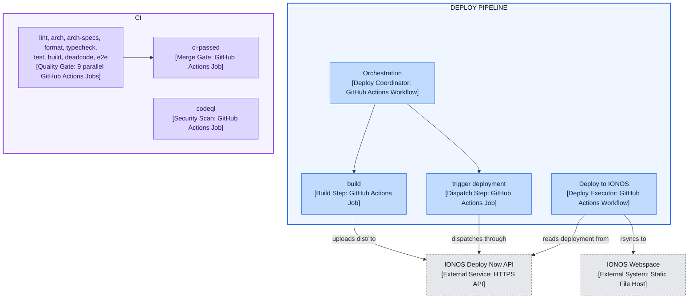
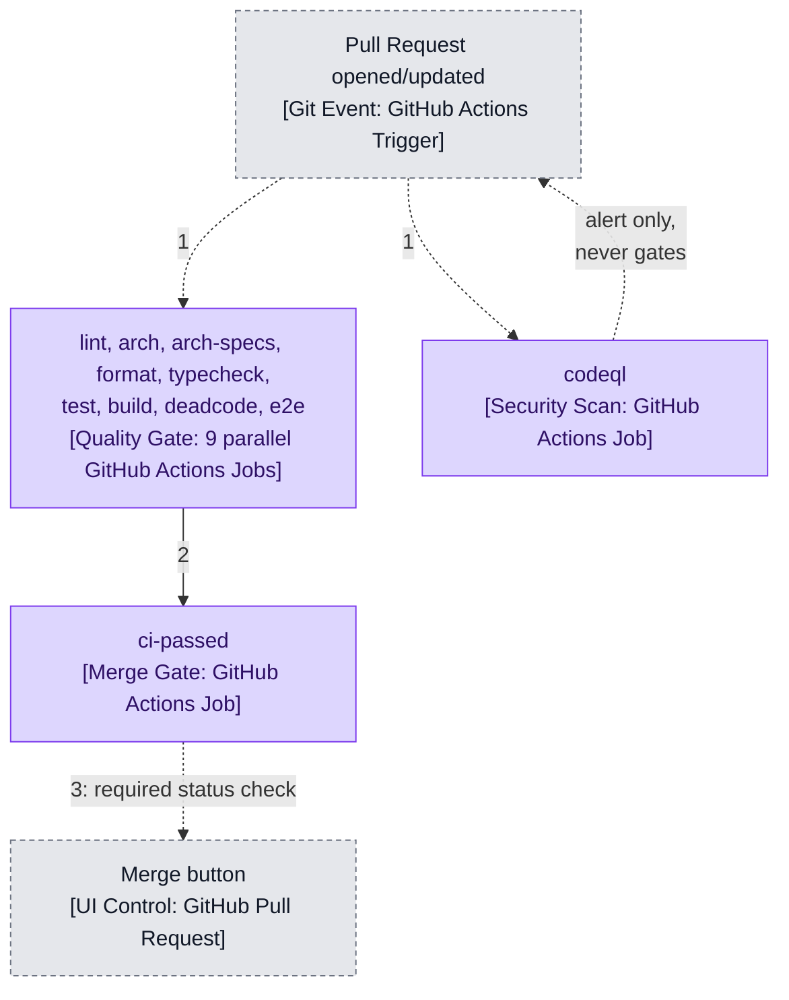
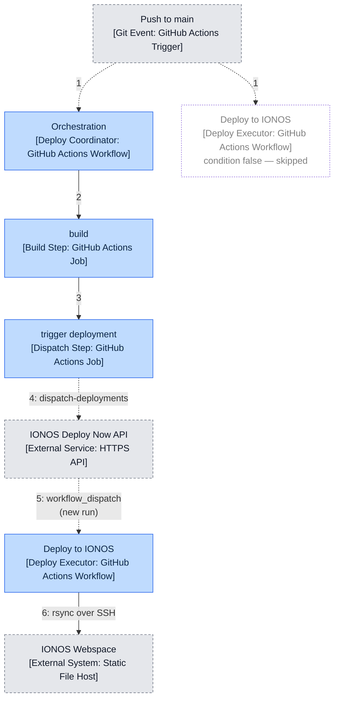

# Deployment & release runbook

EstiMate is a static site with no backend — build once, publish the bundle. Hosting
and CD are handled by **IONOS Deploy Now**, a GitHub-integrated static host: a push
to `main` builds and publishes the production site automatically, no server to operate.
A push to another branch runs the same pipeline too; if that branch has deployment
enabled in Deploy Now, it publishes to the branch's own, separate IONOS deployment. A
deploy can be held for approval; see [Troubleshooting](#troubleshooting).

## Pipeline

### Structure

What exists and what it depends on — no triggers, just dependencies.

*Legend: every arrow is a dependency, labelled with what it is used for; dashed border =
external system.*

| Component | Purpose | Notes |
| --- | --- | --- |
| Orchestration | Checks IONOS readiness (`retrieve-project`), then runs `build` and `trigger deployment` | IONOS-generated, don't hand-edit |
| build (job) | `pnpm build` (`tsc -b && vite build`); uploads `dist/` to IONOS keyed by commit SHA | Defined in `estimate-build.yaml`. Output dir `dist` is Vite's default — the IONOS setup form was originally pre-filled with `public` (source assets, not build output) and had to be corrected |
| trigger deployment (job) | Dispatches the deployment through the IONOS API once `build` has finished | Part of Orchestration |
| Deploy to IONOS | rsyncs `dist/` to the IONOS webspace over SSH, flips it live | IONOS-generated; its `push` trigger only exists so GitHub registers the file — the job itself is gated `if: github.event_name == 'workflow_dispatch'` |
| CI (`lint`/`arch`/`arch-specs`/`format`/`typecheck`/`test`/`build`/`deadcode`/`e2e`, `ci-passed`, `codeql`) | Quality gates + security scan; `ci-passed` is the required status check | Independent of the deploy pipeline — does not gate it; a push where `ci-passed` fails still deploys |

Orchestration and Deploy to IONOS carry a "please do not edit" header — re-run the IONOS
setup flow to regenerate them if the project configuration changes. `estimate-build.yaml`
is where IONOS expects build changes, except for its job name and upload step, which are
marked not to be touched.

### Flow: Pull Request opened/updated

The path that actually gates a merge.

*Legend: numbers give the order; solid = runs after, dotted = event or status; dashed
border = external.*

### Flow: Push to main

Post-merge — this is what actually deploys. A push to another branch with deployment
enabled takes the same path to that branch's own deployment.

*Legend: numbers give the order; solid = runs after, dotted = event or dispatch; dashed
border = external; grey dotted = skipped.*

*GitHub labels the run started at step 5 "manually run by ionos-deploy-now Bot" — that
label applies to any `workflow_dispatch` run, even one triggered by a bot's API call, not
just a human clicking "Run workflow". If that run ends `action_required` with no jobs,
nothing deploys; see [Troubleshooting](#troubleshooting).*

Also running, outside this deploy pipeline:

- **CI re-run** 
  On every push to `main`, CI's quality-gate jobs and the CodeQL scan re-run as a
  post-merge regression check only; the code is already merged (see the Pull Request flow above for where `ci-passed`
  blocks a merge).
- **release-please** 
  On every push to `main`, `.github/workflows/release-please.yml` maintains the release
  PR; it doesn't touch the
  build/deploy path. See [Versioning & releases](#versioning--releases).
- **Nightly real-world E2E** 
  `.github/workflows/e2e-real-world.yml` runs nightly and on demand (`workflow_dispatch`):
  it re-runs the e2e specs against the production Nostr relays instead of the
  local relay `ci.yml`'s `e2e` job uses, and never gates a PR. See
  [ADR-007](adr/007-e2e-dual-mode-signaling.md).

### SPA routing

The app uses a real client-side router (`react-router`, ADR-006) with distinct paths
per screen (`/workspace`, `/join`, `/estimate`, `/summary`). A static host
has no server-side route table, so anything but a request for exactly `/` needs a
rewrite to `index.html` before the client router ever runs — otherwise a hard reload or
a shared link to e.g. `/workspace` 404s at the host, before the app gets a chance to
load. `public/.htaccess` (rsynced into `dist/` by the build, since Vite copies `public/`
verbatim) configures this via `mod_rewrite` for IONOS's Apache-based webspace.

Verify after every deploy that touches routing: load a non-root path directly (not via
in-app navigation) — e.g. `https://<site>/workspace` — and confirm it serves the app
rather than a host 404.

## Docs site

The docs and the specs are also published as a website, built with VitePress from `docs/`
and `specs/` by the `site/` workspace package
([ADR-012](adr/012-docs-website.md)). It is separate from the app's deployment above: it
is served by GitHub Pages, not IONOS.

| What | Where | When |
|---|---|---|
| **Build check** | CI's `docs-site` job (`pnpm docs:build`) | Every pull request and push to `main`; required by `ci-passed` |
| **Deploy** | `.github/workflows/docs-site.yml`: build, upload, deploy to Pages | A push to `main` touching `docs/`, `specs/`, `site/`, the package or workspace files or the lockfile, or a manual run |
| **Local** | `pnpm docs:dev` (live), `pnpm docs:build` then `pnpm docs:preview` (the built site) | Any time; the site is served under `/estimate/` |

**One-time setup** 
In the repo's Settings → Pages, set the source to **GitHub Actions**. Until then the
deploy job fails, and the build check is unaffected.

**When the build fails** 
- *"These specs are linked from no doc"*: link each listed `.feature` file from the doc
  rule it checks, or from the technical concept's "Specs" table.
- *A dead link*: VitePress names the page and the link. A link to a doc the site leaves
  out (the runbook, the PR review catalogue) or to a file outside `docs/` and `specs/`
  goes to GitHub, so a dead link is a real broken path in `docs/`.

## Secrets (repo → Settings → Secrets and variables → Actions)

| Secret | Purpose | Provisioned by | Rotate when |
| --- | --- | --- | --- |
| `IONOS_API_KEY` | Authenticates all `ionos-deploy-now/*-action` steps against the IONOS Deploy Now API | IONOS Deploy Now dashboard, when the project was created | IONOS access is compromised |
| `IONOS_SSH_KEY` | SSH private key used to rsync the build to the IONOS webspace | IONOS Deploy Now dashboard, when the project was created | IONOS access is compromised |
| `IONOS_DEPLOYMENT_<ID>_SSH_USERNAME` | SSH username for one deployment: one secret per deployment (production and each deployed branch); `<ID>` is the deployment UUID from the workflow logs, upper-cased, with `-` as `_` | IONOS Deploy Now dashboard, per deployment | IONOS access is compromised |
| `RELEASE_PLEASE_TOKEN` | A classic PAT (repo scope) used by `release-please-action` instead of the default `GITHUB_TOKEN` | The Developer, by hand | The PAT expires or is revoked |

`RELEASE_PLEASE_TOKEN` is needed because PRs opened with the default `GITHUB_TOKEN` don't
trigger other workflows, so `ci.yml`'s required `ci-passed` check would never post on
release-please's own release PR — and since `main`'s branch protection has
`enforce_admins` on, that PR would be permanently unmergeable without a PAT. Generate a
classic PAT with `repo` scope and add it as this secret before relying on
release-please's release PRs.

## Versioning & releases

EstiMate follows plain [Semantic Versioning](https://semver.org/) (`X.Y.Z`, no
prerelease suffix). The initial release (`0.1.0-preview`) used a `-preview`
prerelease suffix; that was dropped starting with the following release — see
[Dropping the `-preview` suffix](#dropping-the--preview-suffix) below. The project
stays in the `0.x` line (still pre-1.0) until the MVP is feature-complete (live mode +
persistence); that milestone is independent of the suffix and will eventually be marked by a `1.0.0` release.

### How releases are cut

Releases are automated by
[release-please](https://github.com/googleapis/release-please)
(`.github/workflows/release-please.yml`), configured in `release-please-config.json`
and `.release-please-manifest.json`:

1. **PR titles must follow [Conventional Commits](https://www.conventionalcommits.org/)**
   (`feat: ...`, `fix: ...`, `chore: ...`, `docs: ...`, etc.) — because PRs are
   squash-merged (see [collaboration workflow](../../AGENTS.md#collaboration-workflow-github)),
   the PR title becomes the commit message on `main`, and that's what release-please
   parses. Only `feat` and `fix` (and a `!` suffix or `BREAKING CHANGE:` footer) trigger
   a version bump; `chore`/`docs`/`refactor`/`test`/`build`/`ci`/`style` do not. Three
   things keep it that way:
   - **PR title lint** 
     `.github/workflows/pr-title-lint.yml` (`amannn/action-semantic-pull-request`) is a
     required status check on `main` that blocks merging a non-conforming PR title.

     > `pull_request_target` workflows (needed here so the check can't be bypassed by a
     > PR editing its own workflow file) only ever run using the copy of the workflow
     > already on the **base** branch — so `pr-title-lint.yml` had no effect on the PR
     > that introduced it, and only became a real gate once it landed on `main`.
     > Making it a required status check before that would have permanently blocked that
     > PR (a required check that can never report blocks merging forever), so it was
     > added to branch protection as a required check right after that PR merged, not
     > alongside it.
   - **Local commit-msg hook** 
     `.githooks/commit-msg`, wired up by `pnpm install`'s `prepare` script via
     `git config core.hooksPath .githooks`, warns — but doesn't block — on individual
     commits that don't look conventional, since those get squashed away and don't
     matter to release-please directly.
   - **Squash-merge title setting** 
     The repo's squash-merge commit title is pinned to "PR title", so the merge commit
     always matches what the lint checked, regardless of how many commits are on the
     branch.
2. On every push to `main`, release-please computes the next version from commits
   since the last release and opens/updates a standing **release PR** — a bot-owned,
   self-updating branch containing only a `CHANGELOG.md` update and the version bump in
   `package.json` and `.release-please-manifest.json`, no app code.
3. Merging that PR (through the normal required-checks gate) is what cuts the release:
   release-please tags the merge commit `vX.Y.Z` and creates a matching GitHub
   Release.
4. While still pre-1.0 (major stays `0`), `release-please-config.json` sets both
   `bump-minor-pre-major` and `bump-patch-for-minor-pre-major`, which together collapse
   the usual three-tier bump to two:

   | Commit | Bump before `1.0.0` | Setting responsible | Bump from `1.0.0` |
   | --- | --- | --- | --- |
   | `fix` | patch (`0.x.y`) | neither — plain semver | patch |
   | `feat` | patch (`0.x.y`) | `bump-patch-for-minor-pre-major`, redirecting minor down to patch | minor |
   | breaking change (`feat!` / `BREAKING CHANGE:` footer) | minor (`0.x.0`) | `bump-minor-pre-major`, redirecting major down to minor | major |

   Once the project cuts `1.0.0`, both settings stop applying and plain semver resumes.

### Bootstrap

`0.1.0-preview` (the first public deploy) predates this automation and was hand-set:
`package.json`, `CHANGELOG.md`, and `.release-please-manifest.json` were written
directly rather than generated by a release-please PR, since the prior commit history
isn't Conventional-Commits-formatted and would have produced an inaccurate
auto-generated changelog. The deployed merge commit was tagged manually
(`git tag v0.1.0-preview <sha> && git push origin v0.1.0-preview`) once the PR adding
the release automation landed and deployed. release-please only takes over for commits after that point.

### Dropping the `-preview` suffix

Starting with the release after `0.1.0-preview`, the project switched to plain
semver. `package.json` and `.release-please-manifest.json` were hand-corrected from
`0.1.0-preview` to `0.1.0` (the same tracked version, suffix stripped — not a new
tagged release) alongside removing `versioning`/`prerelease`/`prerelease-type` from
`release-please-config.json`. From that point on, release-please's standing release
PR computes plain `0.x.y` versions and tags `vX.Y.Z` with no bracketed suffix.

### Version string in the app

The mode-select screen's "Preview build" tag shows the running version
(`src/pages/mode-select/ui/ModeSelect.tsx`), sourced from `package.json` via a Vite `define`
(`vite.config.ts` → `__APP_VERSION__`) so there's one place the version lives.

## Known gaps / open questions

- `.deploy-now/estimate/config.yaml` is referenced by `estimate-build.yaml`'s upload
  step but was never committed to the repo — the pipeline works without it, so it's
  either optional or IONOS applies a default. Not yet investigated; flag if a future
  IONOS setup change starts requiring it.
- The `.htaccess` rewrite (see [SPA routing](#spa-routing)) hasn't been checked against
  production IONOS yet: load a non-root path directly after the next deploy.

## Troubleshooting

- **Build fails in Actions but not locally:** `pnpm test`/`pnpm lint`/`pnpm
  format:check` never run `tsc -b`, so a real type error can slip past all of them.
  Run `pnpm typecheck` locally (cheaper than a full build) if you've touched types —
  the `CI` workflow's `typecheck` job also catches this on every PR, separately from
  the IONOS `estimate-build.yaml` deploy build.
- **Deploy run shows `action_required` with no jobs:**
  - **Symptom** 
    Both runs of **Deploy to IONOS** for a push, the `push` run and the
    `workflow_dispatch` run from `ionos-deploy-now[bot]`, end `action_required` with
    zero jobs, so nothing deploys. Every later push is held the same way until one run
    is approved, so an unnoticed gate silently stops all deploys.
  - **Cause** 
    A GitHub approval gate, not a config error. Its trigger is not confirmed: it has
    appeared with no change to the workflow files, and it also appears after they are
    regenerated (e.g. by re-provisioning the IONOS project).
  - **Fix** 
    A repo admin approves one run:
    1. Under **Actions**, open the latest flagged run of **Deploy to IONOS** for the
       branch you pushed (`main` for production), with event `workflow_dispatch` and
       actor `ionos-deploy-now[bot]`.
    2. Click **Approve and run workflow**.
    3. Check that the `deploy-to-ionos` job succeeds in every matrix leg on the run's
       latest attempt.
  - **Afterwards** 
    Later pushes deploy on their own. The held `push` runs need no approval, and from
    then on the `push` runs end `skipped` as usual (see [Pipeline](#pipeline)).
- **Root URL 404s or serves stale content:** check the **Orchestration** run's `build`
  job output directory is still `dist`; check the **Deploy to IONOS** run's rsync step
  for errors.
- **"Deploy Now: Build estimate" failure email, but the checks on GitHub show green:**
  - **Symptom** 
    Sent when a release is cut. Nothing fails to deploy; the email is cosmetic.
  - **Cause** 
    The failing run is a separate one, triggered by the git tag release-please pushes
    when cutting a release (see [How releases are cut](#how-releases-are-cut)), not the
    `main`-branch push for the same commit. Its `retrieve-project` job can't resolve
    IONOS branch info for a tag ref (`refs/tags/vX.Y.Z`): `project-action`'s
    `retrieve-info` call fails with `Failed to fetch information about branch
    "refs/tags/...": The setup of this DeployNow project is not fully completed yet`,
    which leaves `steps.project.outputs.info` empty and fails the job's `fromJson(...)`
    outputs. The `main`-branch run for the same commit succeeds, and that is the one
    GitHub's checks show. No IONOS dashboard setting fixes it.
  - **Fix** 
    To silence it, change `estimate-orchestration.yaml`'s shorthand
    `on: [push, workflow_dispatch]` into mapping form with a branch filter,
    `on: { push: { branches: ['**'] }, workflow_dispatch }`, so tag pushes stop
    triggering it. That file is IONOS-generated (see the [Pipeline](#pipeline) table)
    and could be reverted if IONOS re-syncs it; otherwise report it to IONOS Deploy Now
    support.
